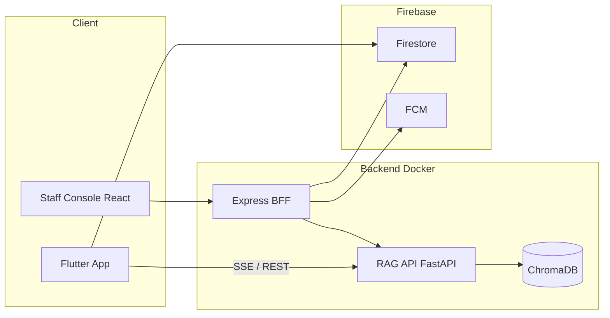

# TLU Assistant System

**Full-stack AI assistant for university students** — Flutter mobile app, RAG pipeline (on-device + server), Firebase realtime chat, Staff Console (React), Docker Compose.

Graduation thesis project (Thang Long University): end-to-end **AI Engineering** system, not a standalone ML model.

---

## Portfolio highlights (for reviewers)

| Area | Contribution |
|------|----------------|
| **RAG** | Semantic Markdown Chunking, abbreviation-aware query expansion, dual local (SQLite) / server (ChromaDB) architecture |
| **Backend** | FastAPI RAG API + SSE streaming, Express.js BFF, Firebase Admin (Firestore, Storage, FCM) |
| **Frontend** | Flutter (student app), React 18 Staff Console |
| **Eval** | 50-question Vietnamese eval set, ablation harness (`services/rag-api/eval/`) — Context Precision, MRR, Faithfulness, Refusal Accuracy |
| **Ops** | `docker compose up --build` runs full backend stack locally |

### Architecture



### Quick start (backend)

```bash
git clone https://github.com/<your-username>/tlu-assistant-system.git
cd tlu-assistant-system
cp .env.example .env          # set GEMINI_API_KEY
mkdir -p secrets && cp /path/to/firebase-sa.json secrets/   # not in Git
docker compose up --build
```

- RAG API: http://127.0.0.1:8080  
- Staff Console: http://127.0.0.1:3000  

See [docs/GIT_SETUP.md](docs/GIT_SETUP.md) for full clone workflow and branch conventions.

---

## Tính năng

| Feature | Mô tả |
|---------|-------|
| 📄 RAG local PDF | Upload PDF → index → hỏi đáp ngay trên máy |
| 🎙️ STT tiếng Việt | Nói → chuyển thành câu hỏi tự động |
| 🔊 TTS tiếng Việt | AI đọc to câu trả lời (có thể dừng/toggle) |
| 🌊 Waveform UI | Animation waveform realtime khi đang nói |
| 💬 Streaming response | Trả lời xuất hiện từng từ như Gemini |
| 📱 Android 11+ / iOS | Một codebase, hai nền tảng |

---

## 🚀 Setup nhanh (5 bước)

### 1. Clone & cài dependencies
```bash
git clone <repo>
cd tlu_ai_assistant
flutter pub get
```

### 2. Thêm Gemini API Key (bắt buộc cho RAG on-device)

Dùng `--dart-define` (không hard-code trong repo):

```bash
flutter run --dart-define=GEMINI_KEY=YOUR_GEMINI_API_KEY
```

### 2b. RAG qua server (Docker) + **một** web cán bộ

1. **API + Staff Console (Docker Compose):** tạo `.env` từ `.env.example`, điền `GEMINI_API_KEY`, (tuỳ chọn) `STAFF_API_KEY`, cấu hình Firebase cho service `staff-console`, rồi:
   ```bash
   docker compose up --build
   ```
   - RAG API: `http://127.0.0.1:8080`
   - **Cổng cán bộ (duy nhất):** `http://127.0.0.1:3000` — đăng nhập bằng **Staff API key** (màn Cài đặt), quản lý `users`, thông báo, đơn, góp ý, vector RAG, audit.

2. **Dev UI riêng (không bắt buộc):** `cd apps/staff-console && npm install && npm run dev` — Vite `http://localhost:5174`, proxy `/api` → server cổng 3001 (chạy `node server/index.mjs` trong cùng lệnh `npm run dev`).

3. **Flutter:** bật *RAG qua server* trong drawer, kèm:
   ```bash
   flutter run \
     --dart-define=GEMINI_KEY=YOUR_KEY \
     --dart-define=API_BASE_URL=http://10.0.2.2:8080 \
     --dart-define=STUDENT_API_KEY=dev-student-key
   ```
   (Emulator Android: `10.0.2.2` = localhost máy host.)

Checklist E2E: [docs/E2E_CHECKLIST.md](docs/E2E_CHECKLIST.md).

### 3. Chạy trên Android
```bash
flutter run --dart-define=GEMINI_KEY=YOUR_GEMINI_API_KEY
```

### 4. Build APK release
```bash
flutter build apk --release
# APK ở: build/app/outputs/flutter-apk/app-release.apk
```

### 5. Build iOS (cần Mac + Xcode 15+)
```bash
flutter build ios --release
# Mở Xcode → Product → Archive → Distribute
```

---

## 📁 Cấu trúc Project

```
lib/
├── config/api_config.dart       ← API_BASE_URL, STUDENT_API_KEY (--dart-define)
├── main.dart
├── services/
│   ├── local_rag_service.dart   ← RAG on-device
│   ├── remote_rag_service.dart  ← RAG backend (SSE)
│   └── ...
services/rag-api/                ← FastAPI + Chroma (Docker, Cloud Run)
apps/staff-console/              ← Web cán bộ duy nhất (Vite + BFF Node + Docker)
docker-compose.yml
docs/DEPLOY_CLOUD_RUN.md
docs/E2E_CHECKLIST.md
```

---

## 🏗️ Flow hoạt động

```
User upload PDF
    │
    ▼
PdfService.extractText()        ← syncfusion_flutter_pdf
    │  Map<trang, text>
    ▼
PdfService.chunk()              ← sliding window 450 chars, overlap 80
    │  List<DocumentChunk>
    ▼
EmbeddingService.embedBatch()   ← Gemini text-embedding-004 (768 dims)
    │  List<List<double>>
    ▼
VectorStore.insertChunks()      ← SQLite on-device
    │
    ▼  (khi user hỏi)
EmbeddingService.embed(query)   ← Embed câu hỏi
    │
    ▼
VectorStore.search()            ← Cosine similarity top-5
    │  List<DocumentChunk>
    ▼
LocalRagService.queryStream()   ← Build prompt + Gemini Flash stream
    │
    ▼
ChatScreen                      ← Stream text → typing animation
    │
    ▼ (nút loa)
TtsService.speak()              ← flutter_tts vi-VN
```

---

## ⚠️ Giới hạn cần biết

| Giới hạn | Chi tiết | Cách xử lý |
|----------|----------|-----------|
| Gemini Free: 60 RPM | Embedding rate limit | Đã có delay 120ms/request |
| PDF scan (ảnh) | Không extract được text | Báo lỗi rõ ràng cho user |
| PDF > 300 trang | Index mất ~15 phút | Progress bar + background isolate |
| STT tiếng Việt | Cần cài TTS engine vi-VN trên máy | Kiểm tra `isVietnameseAvailable()` |
| Cosine search | O(n) với n chunks | Ổn đến ~20.000 chunks (~500 trang) |

---

## 🔧 Tùy chỉnh thêm

**Đổi chunk size** (tăng nếu tài liệu kỹ thuật, giảm nếu hỏi rất cụ thể):
```dart
// lib/services/pdf_service.dart
static const int _chunkSize = 450; // thử 300-700
static const int _overlap   = 80;  // ~18% overlap là chuẩn
```

**Thêm System Prompt riêng cho từng khoa:**
```dart
// lib/services/local_rag_service.dart → systemInstruction
'Bạn là trợ lý chuyên ngành Kỹ thuật Thủy lợi...'
```

**Scale lên backend** khi cần phục vụ 10K sinh viên:
- Thay `VectorStore` (SQLite) → HTTP calls đến ChromaDB trên Cloud Run
- Thay `EmbeddingService` local → endpoint `/embed` trên backend
- Logic RAG không đổi gì cả — đây là lý do tách service rõ ràng

---

*Built with ❤️ by TLU Students — Flutter + Gemini + On-device RAG*
