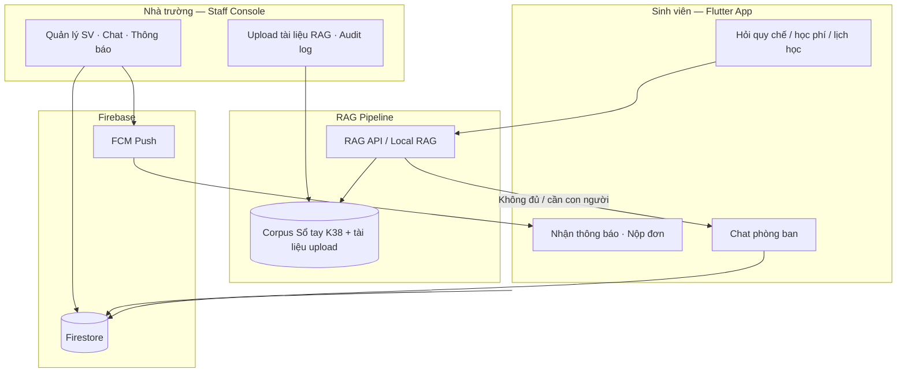
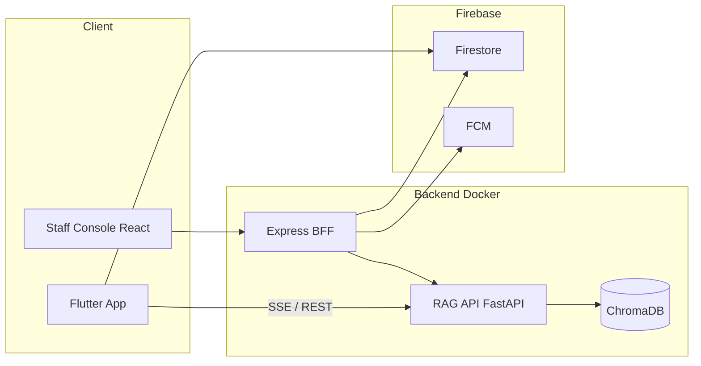

# TLU Assistant System

**Hệ thống thông tin hỗ trợ sinh viên đại học** — tra cứu học vụ bằng AI (RAG), chat realtime với phòng ban, thông báo, đơn từ và quản trị qua Staff Console.

Đồ án tốt nghiệp (ĐH Thăng Long): sản phẩm **full-stack end-to-end**, không chỉ một mô hình ML đơn lẻ.

---

## Hai trụ của hệ thống

| Trụ | Vai trò | Thành phần chính |
|-----|---------|------------------|
| **Hệ thống thông tin (MIS)** | Kênh tương tác sinh viên ↔ nhà trường | Chat phòng ban, thông báo FCM, nộp đơn/góp ý, Staff Console (RBAC, audit), Firebase Firestore |
| **Trí tuệ nhân tạo (RAG)** | Hỏi đáp học vụ có căn cứ, giảm ảo giác LLM | Semantic chunking, query expansion, RAG on-device (Flutter) + server (FastAPI/ChromaDB), bộ eval 50 câu |

Hai trụ dùng chung một nền tảng: sinh viên dùng **một app Flutter**; cán bộ dùng **một web quản trị**; backend gom qua **Docker Compose**.

---

## Luồng nghiệp vụ tiêu biểu



1. Sinh viên **hỏi AI** về quy chế, học phí, CTĐT — câu trả lời bám nguồn tài liệu chính thức.
2. Nếu cần hỗ trợ trực tiếp → **chat với phòng ban** (Đào tạo, Công tác SV, …).
3. Cán bộ xử lý trên **Staff Console**: trả lời chat, gửi thông báo, duyệt đơn, quản lý tài liệu RAG.
4. Cán bộ **upload tài liệu** → index vector → sinh viên hỏi ngay trên corpus mới.

---

## Kiến trúc kỹ thuật (monorepo)

Một repository, nhiều service — chuẩn triển khai sản phẩm nhỏ, dễ demo và bảo vệ KLTN:



| Thư mục | Stack | Vai trò |
|---------|-------|---------|
| `lib/` | Flutter / Dart | App sinh viên: RAG, chat, thông báo, đơn từ |
| `apps/staff-console/` | React + Express | Web cán bộ + BFF (proxy RAG, Firebase Admin) |
| `services/rag-api/` | Python / FastAPI | RAG server, ChromaDB, eval harness |
| `docker-compose.yml` | Docker | Chạy `rag-api` + `staff-console` local |
| `thesis/content_v3/` | — | Nguồn nội dung KLTN (build → `document/*.docx`, không commit) |

---

## Điểm nổi bật (portfolio)

### Hệ thống thông tin
- Chat sinh viên ↔ phòng ban (realtime qua Firestore / BFF)
- Push thông báo FCM, màn hình đơn từ & góp ý
- Staff Console: quản lý user, chat, thông báo, vector RAG, RBAC, audit log
- Kiểm thử E2E: [docs/E2E_CHECKLIST.md](docs/E2E_CHECKLIST.md)

### AI / RAG
- Semantic Markdown Chunking + query expansion (viết tắt học vụ: HP, HK, GPA…)
- Kiến trúc kép: RAG on-device (SQLite) và server (ChromaDB)
- Eval harness 50 câu tiếng Việt: Context Precision, MRR, Faithfulness, Refusal Accuracy
- Ablation 12 cấu hình — xem `services/rag-api/eval/`

---

## Quick start

### Backend (Docker)

```bash
git clone https://github.com/TruongCongHuan/tlu-assistant-system.git
cd tlu-assistant-system
cp .env.example .env          # GEMINI_API_KEY, ...
mkdir -p secrets && cp /path/to/firebase-sa.json secrets/   # không commit
docker compose up --build
```

- RAG API: http://127.0.0.1:8080  
- Staff Console: http://127.0.0.1:3000  

### App sinh viên (Flutter)

```bash
flutter pub get
flutter run \
  --dart-define=GEMINI_KEY=YOUR_KEY \
  --dart-define=API_BASE_URL=http://10.0.2.2:8080 \
  --dart-define=STUDENT_API_KEY=dev-student-key
```

Emulator Android: `10.0.2.2` = localhost máy host.

Chi tiết clone, nhánh, secret: [docs/GIT_SETUP.md](docs/GIT_SETUP.md).

---

## Tính năng app sinh viên

| Tính năng | Mô tả |
|-----------|-------|
| RAG học vụ | Hỏi đáp trên Sổ tay / PDF — local hoặc qua server |
| Chat phòng ban | Liên hệ Đào tạo, Công tác SV, … |
| Thông báo | Nhận push từ phòng ban |
| Đơn từ & góp ý | Nộp và theo dõi trạng thái |
| STT / TTS tiếng Việt | Nói câu hỏi, nghe câu trả lời |
| Streaming | Phản hồi AI hiển thị từng token (SSE) |

---

## Cấu trúc mã nguồn

```
lib/                          # Flutter — app sinh viên
├── services/
│   ├── local_rag_service.dart
│   ├── remote_rag_service.dart
│   └── local_department_chat_repository.dart
apps/staff-console/           # React + BFF Node
services/rag-api/             # FastAPI + Chroma + eval/
├── app/rag.py
└── eval/run_eval.py
docker-compose.yml
docs/
├── E2E_CHECKLIST.md
├── GIT_SETUP.md
└── BAO_CAO_KY_THUAT_RAG.md
```

---

## File không commit

| Path | Lý do |
|------|-------|
| `.env` | API keys |
| `secrets/` | Firebase service account |
| `document/*.docx` | Khóa luận Word (local / Drive) |
| `data/`, `node_modules/`, `build/` | Runtime & artifacts |

---

## Tài liệu thêm

- [E2E checklist](docs/E2E_CHECKLIST.md) — luồng demo bảo vệ
- [Báo cáo kỹ thuật RAG](docs/BAO_CAO_KY_THUAT_RAG.md) — chi tiết pipeline & eval
- [Git workflow](docs/GIT_SETUP.md)

---

*Đồ án tốt nghiệp — Trương Công Huấn, ĐH Thăng Long · Flutter + Firebase + RAG + Docker*
