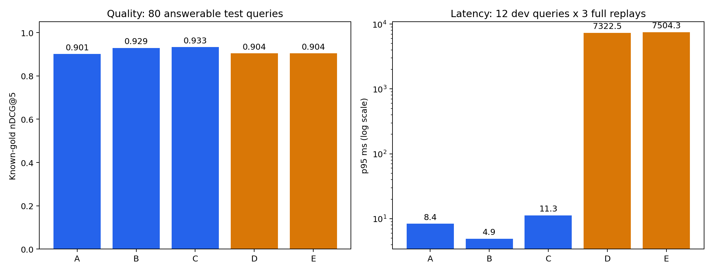
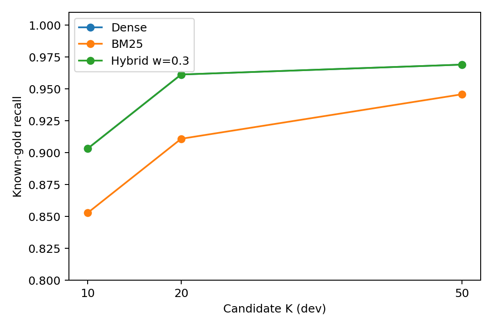

# Báo cáo benchmark retrieval và reranking TLU

Ngày báo cáo: **20/10/2026, Asia/Ho_Chi_Minh**. Run ID chứa timestamp UTC nên có thể mang ngày 19/10. **Hoàn tất các lượt chính và bổ sung.**

## 1. Kết luận và phạm vi

Đã triển khai và chạy retrieval-only, đúng phạm vi người dùng chốt: **không sinh câu trả lời, không gọi judge LLM, không cần Gemini key**. Tất cả số dưới đây lấy từ raw artifacts, không dùng bảng placeholder cũ.

Trên 80 câu test có evidence, Hybrid RRF weight 0,3 đạt nDCG@5 **0,9330**, so với Dense **0,9009**. Đây là mức tăng quan sát **0,0322 điểm**, nhưng CI 95% còn đi qua 0; chưa đủ bằng chứng thống kê để khẳng định vượt trội. Thêm MiniLM reranker đạt nDCG@5 **0,9037**, tăng Hit@5 một câu nhưng giảm MRR so với Hybrid; thời gian xử lý tăng mạnh trên CPU này.

Cấu hình được chọn trên dev **trước khi mở test** là Dense A (nDCG@5 dev 0,8159). Replay có kiểm soát w=0,5 trên cùng hai pool đạt 0,9505, nhưng cấu hình này có dev thấp hơn và được phân tích bổ sung; không coi đó là chiến thắng xác nhận hay tự đổi cấu hình production theo điểm test.

**Các nhãn do agent biên soạn và đối chiếu nguồn, chưa có thẩm định độc lập. Qrels chưa đầy đủ toàn corpus.** Đây là kết quả pilot tái kiểm tra được, không phải đánh giá chất lượng người dùng thực tế đã được chứng nhận.

## 2. Dữ liệu, mô hình và phương pháp

- Corpus đóng băng: `output_md/guide_book_k38_pymupdf.md`, SHA-256 `be6715bb602deb35360f1bf6f28ac39cffd4d5bf9d00636a3d3b15cc0ece51dd`, **321 chunk semantic** dùng chung code với backend.
- Dev: **50 câu**, gồm 43 có evidence và 7 OOS; 23 direct, 12 reasoning, 8 abbreviation. Test: **100 câu**, gồm 80 có evidence và 20 OOS; 64 direct, 15 abbreviation, 1 reasoning. Test thiên về hỏi fact, chưa đại diện tốt cho suy luận nhiều bước.
- Hai split không chung intent group hoặc positive evidence chunk. Test có 56 nhóm ý định cho 80 câu; bootstrap lấy mẫu theo nhóm để không coi paraphrase cùng nguồn là hoàn toàn độc lập.
- Đã audit bộ cũ; sửa các trường hợp như Q05/Q14/Q17 (tín chỉ), Q13 (điểm lần học cuối), Q35 (điểm thi lại tối đa 6,9), Q28 (giờ chiều), Q30 (rèn luyện theo năm). Bản trước/sau và dòng nguồn nằm trong [audit log](../../services/rag-api/eval/datasets/retrieval_v1/audit_log.json).
- Embedding chính: [BAAI/bge-m3](https://huggingface.co/BAAI/bge-m3), dense vector 1024 chiều, normalize, tối đa 512 token; Chroma cosine, index riêng không đụng runtime production.
- Reranker của ma trận đầy đủ: [mMARCO MiniLM](https://huggingface.co/cross-encoder/mmarco-mMiniLMv2-L12-H384-v1), CPU FP32, max length 512, batch 2. BGE reranker theo PDF được đo riêng với int8/256/batch 1 do chi phí CPU.
- Candidate K=20 mỗi nhánh, hybrid hợp nhất tối đa 40 rồi giữ 20; final K=5. Tắt expansion để cô lập thuật toán và không cần API. RRF constant 60, weight 0,3 trong phép thử chính.
- Cache corpus/dev được tạo trước khi chốt cặp thư viện tương thích Chroma (encoder process dùng Transformers 4.48.3/tokenizers 0.21.4); query test dùng môi trường khóa 4.46.3/0.20.3. Ba vector probe từ encoder mới khớp cache với atol=1e-5, rtol=1e-4; phiên bản và provenance được lưu trong manifest. Đây là kiểm tra mẫu, không phải so khớp bit-by-bit toàn corpus.
- A/D và C/E dùng **cùng candidate hash trong từng run**. Generation, faithfulness và refusal accuracy không nằm trong phạm vi. OOS nhận N/A cho retrieval quality, không cộng số 0 vào mẫu số.
- Hit/MRR/Precision/Recall coi grade 2 là evidence trực tiếp; nDCG dùng gain `2^grade − 1` và IDCG từ nhãn. Chỉ số recall là **known-gold recall**, không phải exhaustive corpus recall.

Các sửa lỗi đánh giá gồm bỏ relevance dựa vào một từ heading, sửa IDCG có thể làm nDCG > 1, tách OOS, thêm recall/cutoff rõ ràng, bảo toàn context/ranking và khóa checkpoint bằng config/data/source hashes. Cũng đã sửa double retrieval trong harness cũ; phần generation không được chạy ở đợt này.

## 3. Kết quả test

Mỗi cấu hình chính đã chạy đủ **100/100 câu, 0 lỗi**, trong đó metric chất lượng lấy trên **80 câu answerable**. Các tỷ lệ dưới đây là known-gold metrics trên nhãn thử nghiệm.

| Cấu hình | Hit@5 | MRR@5 | nDCG@5 | Known-gold Recall@20 |
|---|---:|---:|---:|---:|
| A — Dense BGE-M3 | 97.50% | 0.8958 | 0.9009 | 98.75% |
| B — BM25 | 97.50% | 0.9146 | 0.9288 | 98.75% |
| C — Hybrid RRF, w=0,3 | 97.50% | 0.9271 | 0.9330 | 98.75% |
| D — Dense + MiniLM rerank | 98.75% | 0.8781 | 0.9037 | 98.75% |
| E — Hybrid + MiniLM rerank | 98.75% | 0.8781 | 0.9037 | 98.75% |
| C, w=0,5 — replay cùng hai pool | 97.50% | 0.9479 | 0.9505 | 100.00% |

Nguồn đầy đủ: [test chính](test_cpu_bge_mmarco_20261019T183514Z_06530e6b720a/report.md), [per-query CSV](test_cpu_bge_mmarco_20261019T183514Z_06530e6b720a/per_query.csv), [rankings](test_cpu_bge_mmarco_20261019T183514Z_06530e6b720a/rankings.jsonl), [manifest](test_cpu_bge_mmarco_20261019T183514Z_06530e6b720a/manifest.json). Ma trận chính xử lý 4.000 cặp rerank; peak process RSS **1028 MiB**. Có **375/2.000 cặp bị cắt input** ở mỗi cấu hình D/E (18,75%).

### So sánh theo cặp, không chỉ nhìn điểm cao nhất

| So sánh chính | Δ nDCG@5 | CI 95% theo nhóm ý định |
|---|---:|---|
| C-A | +0.0322 | [-0.0091; +0.0719] |
| D-A | +0.0029 | [-0.0534; +0.0536] |
| E-C | -0.0293 | [-0.0778; +0.0115] |

Bootstrap percentile 2.000 lượt, seed 42, 56 intent groups. Cả ba CI chính đều chứa 0. D/A và E/C đều chỉ tăng một Hit@5; exact McNemar p=1,0. Không diễn giải mức tăng này như bằng chứng reranker chắc chắn tốt hơn. [Chi tiết thống kê](test_cpu_bge_mmarco_20261019T183514Z_06530e6b720a/comparison.json).

### Độ nhạy RRF: w=0,5

Cấu hình w=0,5 đã có trong lưới dev. [Replay trên cùng hai pool](fusion_replay_test_cpu_bge_mmarco_20261019T183514Z_06530e6b720a_w0.5/summary.json) xác minh lại fusion w=0,3 trùng parent hash ở đủ 100 câu, sau đó chỉ đổi weight. Kết quả: candidate recall **1,0000**, Hit@5 **0,9750**, nDCG@5 **0,9505**. So với Dense cùng run, Δ nDCG=+0,0496, CI 95% [0,0036; 0,0922]; so với Hybrid w=0,3, Δ=+0,0175, CI [0,0037; 0,0339]. Đây vẫn là phân tích thăm dò có nhiều so sánh và cần test mới trước khi chọn lại hparam; không coi CI này là xác nhận độc lập.

Một [lượt truy xuất mới w=0,5](test_cpu_bge_rrf50_20261019T185355Z_c01c8ec61470/report.md) đạt nDCG 0,9568/Hit@5 0,9875 nhưng có thay đổi ANN, nên không dùng chênh lệch giữa hai run để quy toàn bộ tác động cho weight. Replay dùng candidate file bất biến từ phép thử chính, không đo search latency. [Paired replay comparisons](fusion_replay_test_cpu_bge_mmarco_20261019T183514Z_06530e6b720a_w0.5/comparison.json).

Với w=0,3, dense-only hạng 20 có điểm tối thiểu `0,7/(60+20)=0,00875`, cao hơn sparse-only hạng 1 `0,3/(60+1)≈0,00492`. Khi cả hai nhánh lấy 20 và fusion giữ 20, hit chỉ có ở BM25 không thể chen vào pool cuối. Hybrid khi đó chỉ sắp lại 20 dense hits. Weight 0,5 gỡ ràng buộc này; không đồng nghĩa luôn tốt hơn ở mọi phân bố câu hỏi.

## 4. Độ trễ và tài nguyên

Thiết bị: Intel Core i3-5010U, 2 nhân/4 luồng, khoảng 7,7 GiB RAM, Intel HD Graphics 5500; không dùng GPU NVIDIA. Torch dùng 2 threads. [Hardware inventory](hardware_cpu.json).

| Cấu hình | Số mẫu | p50 (ms) | p95 (ms) |
|---|---:|---:|---:|
| A | 36 | 4.8 | 8.4 |
| B | 36 | 3.0 | 4.9 |
| C | 36 | 8.0 | 11.3 |
| D | 36 | 4527.2 | 7322.5 |
| E | 36 | 4715.7 | 7504.3 |

Nguồn: [180 mẫu timing](latency_cpu_bge_mmarco_20261019T191359Z/samples.csv), [manifest](latency_cpu_bge_mmarco_20261019T191359Z/manifest.json). Mỗi cấu hình có 36 mẫu từ 12 câu dev × 3 lượt, xáo trộn thứ tự. Peak process RSS của lượt này: 936 MiB.

**Đây là cached-vector replay:** gồm search/fusion/rerank, chưa gồm encode query, HTTP hoặc model cold start. Encode query BGE-M3 được đo riêng với median khoảng **449 ms** trên 100 query; không cộng median/p95 này vào các percentile replay rồi gọi là percentile end-to-end. Khả năng sinh câu trả lời không được đo.

Một lượt quality chính cũng có timing đầy đủ trên 100 query, nhưng bảng lặp lại dùng cohort 12 dev riêng. Ba lượt timing không làm tăng số câu độc lập của CI chất lượng. Desktop background load không được kiểm soát như máy benchmark chuyên dụng; không suy ra SLA production từ các số này.

## 5. Đối chiếu BGE reranker trong PDF

[BGE reranker v2 M3](https://huggingface.co/BAAI/bge-reranker-v2-m3) đã được tích hợp và chạy thật. Preflight int8/256 xử lý 3 cặp trong khoảng 3,42 giây inference, model load khoảng 14,22 giây, peak RSS khoảng 1.909 MiB. Đây chỉ là kiểm tra khả thi, không phải benchmark chất lượng; [raw preflight](preflight_cpu.json).

| Cấu hình BGE int8/256 | Hit@5 | MRR@5 | nDCG@5 |
|---|---:|---:|---:|
| A | 100.0% | 0.9500 | 0.8897 |
| C | 90.0% | 0.8500 | 0.7997 |
| D | 90.0% | 0.8000 | 0.7731 |
| E | 90.0% | 0.8000 | 0.7731 |

Nguồn: [báo cáo BGE](dev_cpu_bge_int8_20261019T185448Z_975b8d49d5fa/report.md). Chỉ có 10 câu có evidence trong smoke 12 câu; peak process RSS 2322 MiB. Không gộp vào test 80 câu hoặc kết luận mô hình BGE luôn hơn/kém MiniLM.

BGE int8/256 và MiniLM FP32/512 khác model, precision và token budget. Không dùng bảng này để kết luận riêng tác động model hoặc quantization; không giả rằng BGE đã được chạy toàn bộ 100 câu test ở 512 token.

## 6. Phân tích lỗi có kiểm tra input

| Câu | Dense A | Hybrid C | Hybrid + MiniLM E | Quan sát kiểm tra được |
|---|---:|---:|---:|---|
| T042: thời điểm công bố thay đổi CTĐT | 15 | 3 | 1 | Rerank cứu thứ hạng; evidence nằm trong 324 token |
| T046: CLB tổ chức CALLIOPE | ngoài top-20 | ngoài top-20 | ngoài top-20 | BM25 có gold ở rank 1; w=0,3 loại lexical-only hit; replay w=0,5 đưa gold vào candidate ở rank 6, chưa vào top-5 |
| T063: tổng tín chỉ ngành Thanh nhạc | 1 | 1 | 5 | Pair 682 token; dòng tổng tín chỉ nằm ngoài input 512 |
| T067: tổng tín chỉ Tài chính–Ngân hàng | 1 | 1 | 3 | Pair 634 token; source span bị cắt hoàn toàn |
| T072: tổng tín chỉ Ngôn ngữ Anh | 2 | 1 | 5 | Pair 648 token; source span bị cắt hoàn toàn |
| T078: tổng tín chỉ Truyền thông đa phương tiện | 1 | 1 | 5 | Pair 840 token; source span bị cắt hoàn toàn |

[Case review](test_cpu_bge_mmarco_20261019T183514Z_06530e6b720a/case_review.json) chứa rank, gold source spans và offset tokenizer cho toàn bộ 80 câu. Việc evidence bị cắt là hạn chế input quan sát được, chưa phải chứng minh nhân quả duy nhất của mọi lỗi. Không giải thích chất lượng chỉ bằng việc top-1 thay đổi.

## 7. Sweep trên dev

| Candidate K | Dense Recall@K | BM25 Recall@K | Hybrid w=0,3 Recall@K |
|---:|---:|---:|---:|
| 10 | 0.9031 | 0.8527 | 0.9031 |
| 20 | 0.9612 | 0.9109 | 0.9612 |
| 50 | 0.9690 | 0.9457 | 0.9690 |

Tăng K từ 20 lên 50 chỉ tăng recall Dense khoảng 0,0078 trên bộ dev này nhưng làm tăng số cặp cần rerank 2,5 lần nếu chấm toàn pool. Không gọi K=20 là tối ưu tổng quát; nó là ngân sách thực nghiệm cố định.

| BM25 weight | nDCG Dense cùng run | nDCG Hybrid | Δ Hybrid − Dense |
|---:|---:|---:|---:|
| 0.2 | 0.8159 | 0.8119 | -0.0040 |
| 0.3 | 0.8159 | 0.8020 | -0.0140 |
| 0.5 | 0.8129 | 0.7786 | -0.0343 |

A dùng cùng tham số nhưng có biến động ANN nhỏ giữa các lần mở lại Chroma; Q21 là ví dụ được lưu ở [ANN replay check](ann_replay_check.json). Dùng baseline **cùng run** để tính chênh lệch, không trộn baseline thuận lợi của run khác. Các phép A/D và C/E chính vẫn dùng cùng pool lưu trong run.

## 8. Khuyến nghị và giới hạn

- Trên CPU hiện tại, **giữ rerank tắt mặc định**: chưa có bằng chứng cải thiện nDCG rõ ràng, trong khi tăng thời gian hàng giây. Không diễn giải thành mọi Cross-Encoder hoặc BGE đều không hữu ích.
- Dense/Hybrid và BM25 là các lựa chọn cần cân theo loại câu hỏi. Dense tốt nhất trên dev, Hybrid/BM25 mạnh trên test thiên về fact; chênh lệch phân bố này cần được xác nhận bằng câu hỏi người dùng thật.
- Cần thẩm định độc lập qrels, thêm paraphrase tự nhiên và câu cần nhiều evidence. Test hiện chỉ có một câu category reasoning; không đủ kết luận về multi-hop RAG. Những chunk chưa chấm không mặc nhiên là negative đã xác nhận.
- Đánh giá xử lý bảng dài bằng window/chunk-aware rerank hoặc token budget lớn hơn trên thiết bị phù hợp là bước tiếp theo; chưa đo ở đây. Không bật cấu hình thăm dò chỉ vì đạt điểm cao nhất trên test đã dùng.
- Không chạy generation/judge, không đánh giá refusal, không so trực tiếp với embedding Gemini production. Không có kết quả full BGE 512/GPU trong đợt này.

## 9. Mã nguồn và tái lập

[Hướng dẫn chạy](../../services/rag-api/eval/README_RETRIEVAL.md), [runner](../../services/rag-api/eval/run_retrieval_benchmark.py), [pipeline](../../services/rag-api/eval/run_retrieval_pipeline.py), [reranker](../../services/rag-api/app/reranker.py), [latency probe](../../scripts/benchmark_retrieval_latency.py), [case analysis](../../scripts/analyze_retrieval_cases.py), [fusion replay](../../scripts/replay_retrieval_fusion.py).

Các manifest ghi model revisions, hashes corpus/qrels/config/mã nguồn, phiên bản thư viện, hardware, seed và lệnh chạy. Môi trường đã khóa trong `services/rag-api/requirements-benchmark.lock`; tải CPU torch đúng bản trước khi cài lock. Kiểm tra cuối: **18/18 regression tests đạt**, `pip check` không có xung đột, compile Python và `git diff --check` đạt. [Validation](validation.json) ghi kiểm tra coverage, candidate pool và 180 mẫu đo độ trễ.

Báo cáo kỹ thuật cũ đã được gắn cảnh báo vì số ablation trùng placeholder. Tất cả kết luận mới ở đây dẫn tới JSON/CSV/ranking thật. Code vẫn để `RERANK_MODE=none` mặc định và không ghi đè dữ liệu production.

