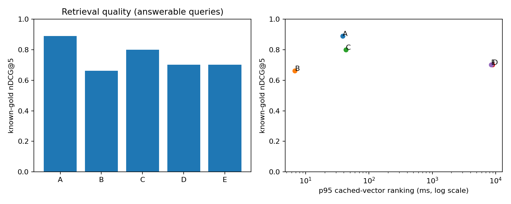

# Báo cáo benchmark retrieval/reranking TLU

Run: `dev_cpu_bge_mmarco_20261019T182056Z_81afc285bd41`; split `dev`; smoke=True.

**Kết quả đo thật trên bộ nhãn thử nghiệm do agent biên soạn và kiểm tra nguồn; chưa được người độc lập thẩm định.**
Không sinh câu trả lời hoặc gọi judge LLM, theo phạm vi người dùng đã chốt.

Corpus có 321 chunk; candidate K=20, final K=5.
Embedding: `BAAI/bge-m3`; reranker: `cross-encoder/mmarco-mMiniLMv2-L12-H384-v1`.
Chế độ int8: False; peak process RSS=997 MiB.
Các revision, cấu hình, source hashes và môi trường nằm trong [manifest](manifest.json).

| Config | n answerable | Candidate Hit@K | Known-gold Recall@K | Hit@5 | MRR@5 | nDCG@5 | Ranking p50/p95 ms |
|---|---:|---:|---:|---:|---:|---:|---|
| A | 10 | 1.0000 | 0.9333 | 1.0000 | 0.9500 | 0.8897 | 6.5 / 38.3 |
| B | 10 | 0.9000 | 0.8167 | 0.9000 | 0.7083 | 0.6620 | 3.7 / 6.8 |
| C | 10 | 1.0000 | 0.9333 | 0.9000 | 0.8500 | 0.7997 | 10.5 / 43.2 |
| D | 10 | 1.0000 | 0.9333 | 0.9000 | 0.7250 | 0.7015 | 6217.3 / 8894.2 |
| E | 10 | 1.0000 | 0.9333 | 0.9000 | 0.7250 | 0.7015 | 6299.6 / 8471.6 |

A = Dense; B = BM25; C = Hybrid RRF; D = Dense + Cross-Encoder; E = Hybrid + Cross-Encoder.

## So sánh theo cặp

- D-A: Δ nDCG@5=-0.1882, bootstrap CI 95% [-0.4269, +0.0000], 10 câu/9 nhóm; Hit tăng 0, giảm 1 câu.
- E-C: Δ nDCG@5=-0.0982, bootstrap CI 95% [-0.2578, +0.0000], 10 câu/9 nhóm; Hit tăng 0, giảm 0 câu.
- C-A: Δ nDCG@5=-0.0900, bootstrap CI 95% [-0.3222, +0.0820], 10 câu/9 nhóm; Hit tăng 0, giảm 1 câu.

## Giới hạn và cách đọc

- Đây là known-gold metrics trên evidence đã chỉ định, chưa phải qrels đầy đủ toàn corpus. Candidate ngoài tập positive chưa được gán nhãn âm; không kết luận mọi kết quả khác là sai.
- OOS bị loại khỏi mẫu số retrieval; không thể suy ra tỷ lệ từ chối vì không chạy generation hoặc bộ phân loại answerability.
- Độ trễ đo Chroma/BM25/rerank với vector query đã cache, chưa gồm embedding query, cold model load hoặc network. Các trường thời gian thành phần không đồng nghĩa latency API live.
- Lượt lặp cấu hình: 1; nếu chỉ 1 lượt thì p95 chỉ mô tả các câu trong lượt đó, chưa đáp ứng đánh giá độ ổn định vận hành 3 lượt.
- Hai cấu hình có/không rerank dùng cùng hash candidate pool. Các intent cùng nguồn được giữ cùng split và dùng cluster bootstrap.
- Bảng chi tiết gồm coverage và lỗi trong [summary](summary.json); không dùng số mẫu cũ làm baseline.

## Artifacts

[Per query](per_query.csv), [rankings](rankings.jsonl), [candidate pools](candidates.jsonl), [paired comparisons](comparison.json), [latency](latency.csv), [errors](errors.jsonl).

## Ví dụ kiểm tra được

| Query | Config | Top-5 chunk IDs | Loại |
|---|---|---|---|
| Q01 | D | k38-v1:4:10bf9b2ebc7df41a, k38-v1:236:03baf4dcae1f9dc3, k38-v1:67:df287f2b0f7cc4ad, k38-v1:232:517be18c962e8ea8, k38-v1:226:16ab63db44b1c2a5 | hit |
| Q01 | B | k38-v1:4:10bf9b2ebc7df41a, k38-v1:78:b61697aa7070d838, k38-v1:67:df287f2b0f7cc4ad, k38-v1:232:517be18c962e8ea8, k38-v1:58:b50412aa076f330a | hit |
| Q01 | C | k38-v1:4:10bf9b2ebc7df41a, k38-v1:67:df287f2b0f7cc4ad, k38-v1:237:e733b077d8b8a298, k38-v1:232:517be18c962e8ea8, k38-v1:228:b1c434d4d005776b | hit |
| Q19 | D | k38-v1:158:1dfa066f467384cb, k38-v1:40:5920b9fc6786175a, k38-v1:62:6d0490d75f02cf53, k38-v1:43:668cddbadf2d4a86, k38-v1:39:1addba2fbe980ec7 | top5_miss |
| Q19 | C | k38-v1:43:668cddbadf2d4a86, k38-v1:37:07aa4f5ca2b93f9a, k38-v1:40:5920b9fc6786175a, k38-v1:39:1addba2fbe980ec7, k38-v1:33:718340b37c8ea584 | top5_miss |
| Q19 | E | k38-v1:158:1dfa066f467384cb, k38-v1:40:5920b9fc6786175a, k38-v1:62:6d0490d75f02cf53, k38-v1:43:668cddbadf2d4a86, k38-v1:39:1addba2fbe980ec7 | top5_miss |
| Q19 | B | k38-v1:111:996ad9ca2c625691, k38-v1:43:668cddbadf2d4a86, k38-v1:44:625bec22a87530a0, k38-v1:127:e75c4f1ab3cf7a9d, k38-v1:41:abde056d9e80c8a7 | candidate_miss |
