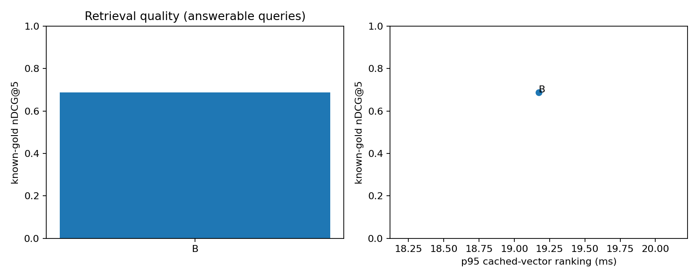

# Báo cáo benchmark retrieval/reranking TLU

Run: `dev_local_bge_20261019T180344Z_e296e21f4974`; split `dev`; smoke=False.

**Kết quả đo thật trên bộ nhãn thử nghiệm do agent biên soạn và kiểm tra nguồn; chưa được người độc lập thẩm định.**
Không sinh câu trả lời hoặc gọi judge LLM, theo phạm vi người dùng đã chốt.

Corpus có 321 chunk; candidate K=20, final K=5.
Embedding: `BAAI/bge-m3`; reranker: `BAAI/bge-reranker-v2-m3`.
Chế độ int8: False; peak process RSS=46 MiB.
Các revision, cấu hình, source hashes và môi trường nằm trong [manifest](manifest.json).

| Config | n answerable | Candidate Hit@K | Known-gold Recall@K | Hit@5 | MRR@5 | nDCG@5 | Ranking p50/p95 ms |
|---|---:|---:|---:|---:|---:|---:|---|
| B | 43 | 0.9302 | 0.9109 | 0.8605 | 0.6810 | 0.6879 | 7.5 / 19.2 |

A = Dense; B = BM25; C = Hybrid RRF; D = Dense + Cross-Encoder; E = Hybrid + Cross-Encoder.

## So sánh theo cặp

## Giới hạn và cách đọc

- Đây là known-gold metrics trên evidence đã chỉ định, chưa phải qrels đầy đủ toàn corpus. Candidate ngoài tập positive chưa được gán nhãn âm; không kết luận mọi kết quả khác là sai.
- OOS bị loại khỏi mẫu số retrieval; không thể suy ra tỷ lệ từ chối vì không chạy generation hoặc bộ phân loại answerability.
- Độ trễ đo Chroma/BM25/rerank với vector query đã cache, chưa gồm embedding query, cold model load hoặc network. Các trường thời gian thành phần không đồng nghĩa latency API live.
- Lượt lặp cấu hình: 1; nếu chỉ 1 lượt thì p95 chỉ mô tả các câu trong lượt đó, chưa đáp ứng đánh giá độ ổn định vận hành 3 lượt.
- Hai cấu hình có/không rerank dùng cùng hash candidate pool. Các intent cùng nguồn được giữ cùng split và dùng cluster bootstrap.
- Bảng chi tiết gồm coverage và lỗi trong [summary](summary.json); không dùng số mẫu cũ làm baseline.

## Artifacts

[Per query](per_query.csv), [rankings](rankings.jsonl), [candidate pools](candidates.jsonl), [paired comparisons](comparison.json), [latency](latency.csv), [errors](errors.jsonl).

## Ví dụ kiểm tra được

| Query | Config | Top-5 chunk IDs | Loại |
|---|---|---|---|
| Q01 | B | k38-v1:4:10bf9b2ebc7df41a, k38-v1:78:b61697aa7070d838, k38-v1:67:df287f2b0f7cc4ad, k38-v1:232:517be18c962e8ea8, k38-v1:58:b50412aa076f330a | hit |
| Q02 | B | k38-v1:6:639a93207203e124, k38-v1:8:dff039bef07d33a5, k38-v1:7:71d8345c3d328321, k38-v1:55:4faca73f70dd9772, k38-v1:75:a7f6e619b8ae42ba | hit |
| Q03 | B | k38-v1:114:19b53d7696ef4c68, k38-v1:113:cd083c4232efd2e8, k38-v1:115:251a2fbf5420ac22, k38-v1:132:aaa3a23cfa288abd, k38-v1:125:5067a5f53fd2590a | hit |
| Q09 | B | k38-v1:256:db9d4d137a8a1ef2, k38-v1:260:7546dca23d073d12, k38-v1:232:517be18c962e8ea8, k38-v1:234:c75680dc8935264f, k38-v1:206:6abef9b69f08a43f | top5_miss |
| Q19 | B | k38-v1:111:996ad9ca2c625691, k38-v1:43:668cddbadf2d4a86, k38-v1:44:625bec22a87530a0, k38-v1:127:e75c4f1ab3cf7a9d, k38-v1:41:abde056d9e80c8a7 | candidate_miss |
| Q37 | B | k38-v1:77:008450908b6af1bd, k38-v1:65:5480d616b23fb0e1, k38-v1:150:dfb34525a895c19f, k38-v1:80:1ada504ccb3bb5d7, k38-v1:39:1addba2fbe980ec7 | top5_miss |
| Q39 | B | k38-v1:39:1addba2fbe980ec7, k38-v1:294:661f2b98ff646c1d, k38-v1:297:fc41f974ac27e395, k38-v1:293:015bc56695b9e2ef, k38-v1:43:668cddbadf2d4a86 | candidate_miss |
| Q49 | B | k38-v1:294:661f2b98ff646c1d, k38-v1:154:65a81972c52988ca, k38-v1:28:573b2ed3a7d642f8, k38-v1:274:f821225b68d8fd19, k38-v1:275:f821225b68d8fd19 | top5_miss |
| Q50 | B | k38-v1:264:84b707a2395c693c, k38-v1:108:119a7d3d09e1b40f, k38-v1:263:1abdf96a42ea6080, k38-v1:6:639a93207203e124, k38-v1:100:789750146a65b68c | candidate_miss |
