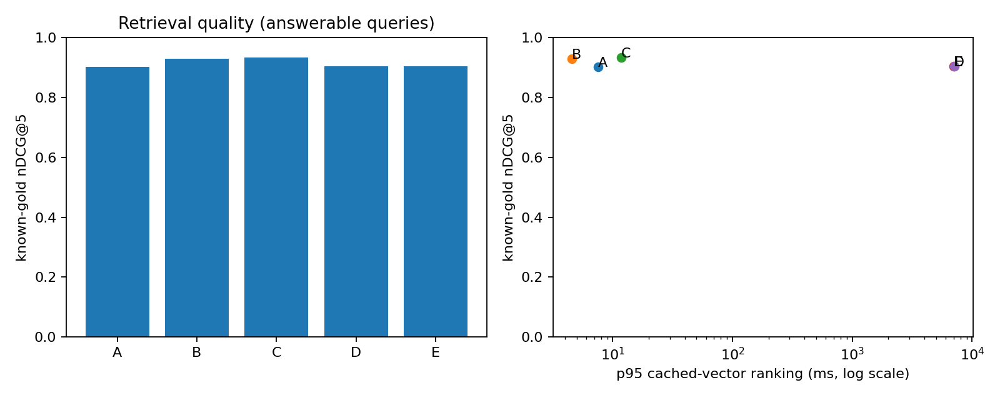

# Báo cáo benchmark retrieval/reranking TLU

Run: `test_cpu_bge_mmarco_20261019T183514Z_06530e6b720a`; split `test`; smoke=False.

**Kết quả đo thật trên bộ nhãn thử nghiệm do agent biên soạn và kiểm tra nguồn; chưa được người độc lập thẩm định.**
Không sinh câu trả lời hoặc gọi judge LLM, theo phạm vi người dùng đã chốt.

Corpus có 321 chunk; candidate K=20, final K=5.
Embedding: `BAAI/bge-m3`; reranker: `cross-encoder/mmarco-mMiniLMv2-L12-H384-v1`.
Chế độ int8: False; peak process RSS=1028 MiB.
Các revision, cấu hình, source hashes và môi trường nằm trong [manifest](manifest.json).

| Config | n answerable | Candidate Hit@K | Known-gold Recall@K | Hit@5 | MRR@5 | nDCG@5 | Ranking p50/p95 ms |
|---|---:|---:|---:|---:|---:|---:|---|
| A | 80 | 0.9875 | 0.9875 | 0.9750 | 0.8958 | 0.9009 | 4.9 / 7.6 |
| B | 80 | 0.9875 | 0.9875 | 0.9750 | 0.9146 | 0.9288 | 2.9 / 4.6 |
| C | 80 | 0.9875 | 0.9875 | 0.9750 | 0.9271 | 0.9330 | 8.2 / 11.8 |
| D | 80 | 0.9875 | 0.9875 | 0.9875 | 0.8781 | 0.9037 | 5716.4 / 7015.3 |
| E | 80 | 0.9875 | 0.9875 | 0.9875 | 0.8781 | 0.9037 | 5811.2 / 7081.3 |

A = Dense; B = BM25; C = Hybrid RRF; D = Dense + Cross-Encoder; E = Hybrid + Cross-Encoder.

## So sánh theo cặp

- D-A: Δ nDCG@5=+0.0029, bootstrap CI 95% [-0.0534, +0.0536], 80 câu/56 nhóm; Hit tăng 1, giảm 0 câu.
- E-C: Δ nDCG@5=-0.0293, bootstrap CI 95% [-0.0778, +0.0115], 80 câu/56 nhóm; Hit tăng 1, giảm 0 câu.
- C-A: Δ nDCG@5=+0.0322, bootstrap CI 95% [-0.0091, +0.0719], 80 câu/56 nhóm; Hit tăng 1, giảm 1 câu.

## Giới hạn và cách đọc

- Đây là known-gold metrics trên evidence đã chỉ định, chưa phải qrels đầy đủ toàn corpus. Candidate ngoài tập positive chưa được gán nhãn âm; không kết luận mọi kết quả khác là sai.
- OOS bị loại khỏi mẫu số retrieval; không thể suy ra tỷ lệ từ chối vì không chạy generation hoặc bộ phân loại answerability.
- Độ trễ đo Chroma/BM25/rerank với vector query đã cache, chưa gồm embedding query, cold model load hoặc network. Các trường thời gian thành phần không đồng nghĩa latency API live.
- Lượt lặp cấu hình: 1; nếu chỉ 1 lượt thì p95 chỉ mô tả các câu trong lượt đó, chưa đáp ứng đánh giá độ ổn định vận hành 3 lượt.
- Hai cấu hình có/không rerank dùng cùng hash candidate pool. Các intent cùng nguồn được giữ cùng split và dùng cluster bootstrap.
- Bảng chi tiết gồm coverage và lỗi trong [summary](summary.json); không dùng số mẫu cũ làm baseline.

## Artifacts

[Per query](per_query.csv), [rankings](rankings.jsonl), [candidate pools](candidates.jsonl), [paired comparisons](comparison.json), [latency](latency.csv), [errors](errors.jsonl).

## Ví dụ kiểm tra được

| Query | Config | Top-5 chunk IDs | Loại |
|---|---|---|---|
| T001 | D | k38-v1:11:4ea346ea0128f772, k38-v1:269:1bf14999acdd3f6e, k38-v1:270:569653e62c83d72e, k38-v1:271:569653e62c83d72e, k38-v1:14:e63694235176513a | hit |
| T001 | B | k38-v1:11:4ea346ea0128f772, k38-v1:35:34ba3eb139ebd267, k38-v1:269:1bf14999acdd3f6e, k38-v1:289:b5806d98ba20428d, k38-v1:33:718340b37c8ea584 | hit |
| T001 | C | k38-v1:11:4ea346ea0128f772, k38-v1:269:1bf14999acdd3f6e, k38-v1:270:569653e62c83d72e, k38-v1:271:569653e62c83d72e, k38-v1:277:7d1943fa8587a107 | hit |
| T005 | B | k38-v1:70:5bdc3fa3632d3808, k38-v1:269:1bf14999acdd3f6e, k38-v1:223:63d3b6c9c30af4e7, k38-v1:284:45593b7922ccfde8, k38-v1:90:0823a5b368edb8b9 | candidate_miss |
| T005 | C | k38-v1:269:1bf14999acdd3f6e, k38-v1:284:45593b7922ccfde8, k38-v1:270:569653e62c83d72e, k38-v1:271:569653e62c83d72e, k38-v1:11:4ea346ea0128f772 | top5_miss |
| T042 | A | k38-v1:44:625bec22a87530a0, k38-v1:136:43ac58ce8ff95590, k38-v1:45:ff1921e53a2f256f, k38-v1:109:d31c40a19cdfd7fc, k38-v1:54:3ddcd926a17da0c1 | top5_miss |
| T046 | D | k38-v1:265:d611c46728beacd3, k38-v1:290:1e5e16e4bb47a8f7, k38-v1:288:f130a073361a6f63, k38-v1:282:78009815023b3771, k38-v1:303:a279180b254e8f8a | candidate_miss |
| T046 | A | k38-v1:316:2257f4e730cff4a3, k38-v1:302:247cf79dd6c738dc, k38-v1:311:2d94c2e7d5e4fbe7, k38-v1:317:d1c19a84aee0f57e, k38-v1:319:aca245b934ce449a | candidate_miss |
| T070 | B | k38-v1:69:3511a3fab6869bf5, k38-v1:43:668cddbadf2d4a86, k38-v1:256:db9d4d137a8a1ef2, k38-v1:21:ddf6470febd3e174, k38-v1:200:53b7038fa0b70990 | top5_miss |
