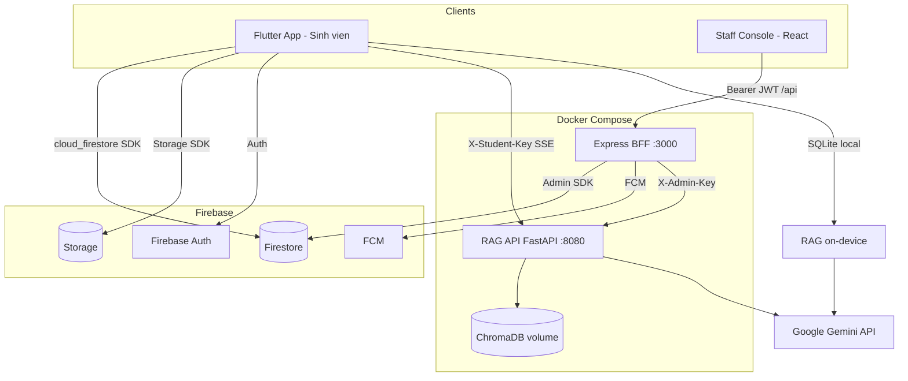
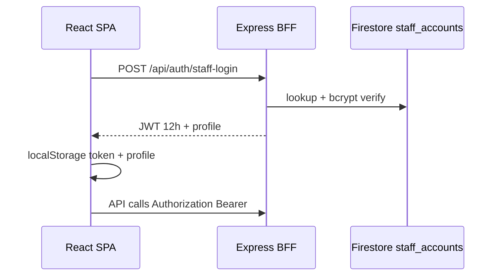
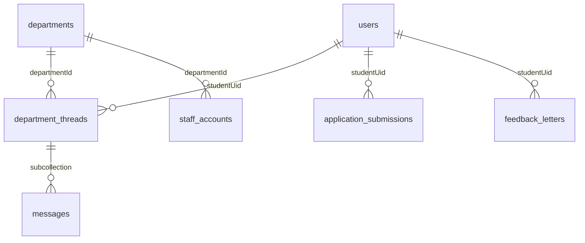
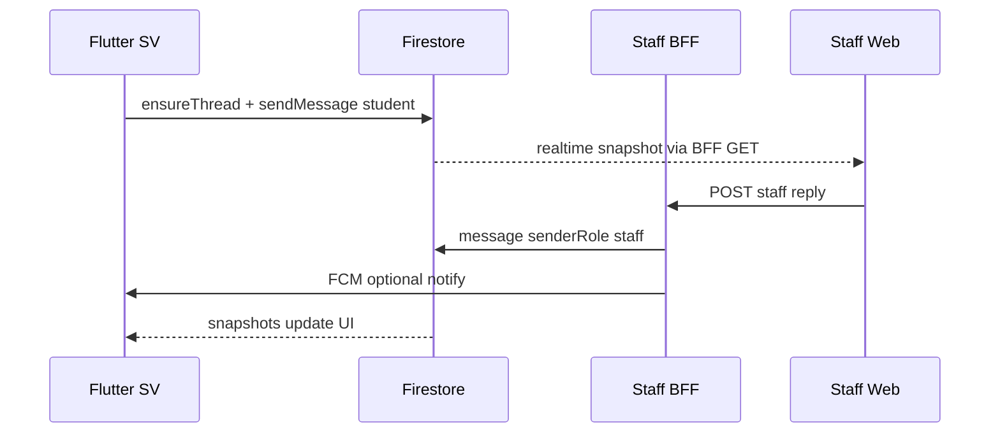

# Mô tả kỹ thuật dự án — TLU AI Assistant

Tài liệu này mô tả **toàn bộ hệ thống** trong workspace `[/Users/huan/Documents/Graduation_Thesis](/Users/huan/Documents/Graduation_Thesis)` để bạn copy gửi Claude viết khóa luận. Tên sản phẩm: **TLU AI Assistant** — trợ lý AI cho sinh viên Đại học Thăng Long (TLU), kèm kênh tương tác với các phòng ban qua web cán bộ.

---

## 1. Bối cảnh và mục tiêu hệ thống

### 1.1 Vấn đề giải quyết

Sinh viên cần:

- Hỏi đáp học thuật / quy chế dựa trên tài liệu của trường (RAG).
- Tra cứu nhanh bằng giọng nói (STT) và nghe câu trả lời (TTS).
- Liên hệ phòng ban (cố vấn, CTSV, đào tạo, tài chính, tâm lý) mà không phải gọi/email rời rạc.
- Nhận thông báo nhà trường, nộp đơn hành chính, gửi góp ý.
- Mở các cổng web học vụ (E-Learning, đăng ký học phần, học phí) trong app.

Cán bộ cần:

- Quản lý hồ sơ sinh viên, trả lời chat theo phòng ban.
- Phát hành thông báo (kèm push FCM).
- Xem đơn nộp và thư góp ý.
- Quản lý tài liệu RAG phục vụ trợ lý AI.
- Phân quyền tài khoản cán bộ và ghi audit.

### 1.2 Phạm vi triển khai


| Thành phần        | Công nghệ                                             | Vai trò                                |
| ----------------- | ----------------------------------------------------- | -------------------------------------- |
| **App sinh viên** | Flutter (`tlu_ai_assistant`)                          | Client mobile (Android/iOS)            |
| **Web cán bộ**    | React 18 + Vite + Tailwind (`apps/staff-console`)     | Dashboard "TLU — Cán bộ"               |
| **BFF cán bộ**    | Express (`server/index.mjs`)                          | API + JWT + proxy RAG + Firebase Admin |
| **RAG API**       | Python FastAPI + Chroma + Gemini (`services/rag-api`) | Vector DB server-side, chat SSE        |
| **Cơ sở dữ liệu** | Google Cloud Firestore                                | Dữ liệu nghiệp vụ realtime             |
| **Lưu trữ file**  | Firebase Storage                                      | Đính kèm đơn từ                        |
| **Push**          | Firebase Cloud Messaging                              | Thông báo broadcast + chat             |
| **Triển khai**    | Docker Compose                                        | `rag-api` :8080, `staff-console` :3000 |


---

## 2. Kiến trúc tổng thể




### 2.1 Mô hình triển khai logic

- **Firestore**: nguồn sự thật cho chat phòng ban, thông báo, đơn, góp ý, hồ sơ SV.
- **Chroma (rag-api)**: vector embeddings tài liệu quy chế/hướng dẫn — **không** lưu trong Firestore.
- **SQLite (Flutter)**: vector store on-device khi dùng RAG local.
- **Staff BFF**: lớp trung gian bắt buộc cho cán bộ (JWT, bcrypt, audit, FCM broadcast); sinh viên ghi Firestore trực tiếp theo `[firestore.rules](firestore.rules)`.

### 2.2 Cổng mạng (dev/Docker)


| Dịch vụ        | URL dev                                     | Ghi chú                               |
| -------------- | ------------------------------------------- | ------------------------------------- |
| RAG API        | `http://127.0.0.1:8080`                     | Flutter emulator dùng `10.0.2.2:8080` |
| Staff (Docker) | `http://127.0.0.1:3000`                     | UI + API cùng origin                  |
| Staff (dev)    | Vite `5174` → proxy `/api` → Express `3001` | `npm run dev`                         |
| Firestore      | Firebase project                            | Rules + indexes deploy riêng          |


Cấu hình: `[.env.example](/Users/huan/Documents/Graduation_Thesis/.env.example)`, `[docker-compose.yml](/Users/huan/Documents/Graduation_Thesis/docker-compose.yml)`.

---

## 3. Ứng dụng Flutter — phía sinh viên

**Package:** `tlu_ai_assistant` — `[pubspec.yaml](/Users/huan/Documents/Graduation_Thesis/pubspec.yaml)`

### 3.1 Cấu trúc mã nguồn

```
lib/
├── main.dart                 # Bootstrap, MultiProvider
├── config/                   # Firebase, API, demo, department catalog
├── models/                   # ChatMessage, PdfDoc, DocumentChunk, notifications
├── providers/                # ChatProvider (AI chat state)
├── screens/                  # Màn hình chính
├── services/                 # RAG, auth, Firestore repos, TTS/STT
├── widgets/                  # Drawer, auth gate, input bar
└── theme/                    # Dark theme
```

### 3.2 Nhóm tính năng chi tiết

#### A. Trợ lý AI (RAG) — trọng tâm kỹ thuật

**Hai chế độ** (toggle trong drawer):


| Chế độ        | Service            | Luồng                                                             |
| ------------- | ------------------ | ----------------------------------------------------------------- |
| **On-device** | `LocalRagService`  | PDF → chunk → Gemini embed → SQLite cosine search → Gemini stream |
| **Server**    | `RemoteRagService` | HTTP SSE `POST /v1/chat/stream` + header `X-Student-Key`          |


**Pipeline RAG local** (theo [README.md](/Users/huan/Documents/Graduation_Thesis/README.md)):

1. `PdfService.extractText()` — trích xuất text theo trang.
2. `PdfService.chunk()` — sliding window ~450 ký tự, overlap ~80.
3. `EmbeddingService.embedBatch()` — Gemini embedding (768 dims).
4. `VectorStore` — SQLite, cosine similarity top-5.
5. `LocalRagService.queryStream()` — prompt + Gemini Flash streaming.
6. `TtsService` / `SttService` — đọc/to tiếng Việt.

**Pipeline RAG server** (`services/rag-api`):

- Admin upload PDF qua staff-console → BFF proxy → Chroma ingest (background job).
- Sinh viên chat qua SSE; auth `STUDENT_API_KEY`.

File then chốt: `[lib/services/local_rag_service.dart](/Users/huan/Documents/Graduation_Thesis/lib/services/local_rag_service.dart)`, `[lib/services/remote_rag_service.dart](/Users/huan/Documents/Graduation_Thesis/lib/services/remote_rag_service.dart)`, `[lib/providers/chat_provider.dart](/Users/huan/Documents/Graduation_Thesis/lib/providers/chat_provider.dart)`.

#### B. Chat phòng ban (sinh viên ↔ cán bộ)

- **Repository:** `[department_chat_repository.dart](/Users/huan/Documents/Graduation_Thesis/lib/services/department_chat_repository.dart)`
- **Thread ID:** `{studentUid}_{departmentId}` (ví dụ `abc_co_van`)
- **5 phòng ban** (`[department_catalog.dart](/Users/huan/Documents/Graduation_Thesis/lib/config/department_catalog.dart)`): `co_van`, `ct_sv`, `dao_tao`, `tai_chinh`, `tam_ly`
- Realtime: `snapshots()` trên `department_threads/{id}/messages`
- Sinh viên gửi với `senderRole: 'student'`; cán bộ trả lời qua BFF với `senderRole: 'staff'`

#### C. Thông báo nhà trường

- Collection `school_notifications` — stream Firestore
- FCM topic `school_broadcast`; token lưu `users/{uid}.fcmToken`
- Màn hình: `[notifications_screen.dart](/Users/huan/Documents/Graduation_Thesis/lib/screens/notifications_screen.dart)`

#### D. Đơn từ và góp ý

- **Đơn:** upload file → Firebase Storage → metadata `application_submissions`
- **Góp ý:** `feedback_letters` (hỗ trợ ẩn danh)
- Màn hình: `application_form_screen.dart`, `feedback_letter_screen.dart`

#### E. Cổng web học vụ

- WebView: E-Learning, đăng ký HP, học phí — `[school_web_config.dart](/Users/huan/Documents/Graduation_Thesis/lib/config/school_web_config.dart)`

#### F. Xác thực

- **Hiện tại:** Anonymous Auth khi khởi động (`firebase_session_service.dart`); gate auth có thể bypass (`FirebaseAuthGate.kBypassAuthGate`)
- **Sẵn sàng:** Google Sign-In chỉ `@thanglong.edu.vn` (`school_auth_service.dart`)
- Rules Firestore: `isStudentLike()` = email trường **hoặc** anonymous

#### G. Chế độ demo (báo cáo / screenshot)

- `DemoReportConfig.enabled = true` → bỏ Firebase, dùng dữ liệu giả — tắt khi chạy production/E2E thật.

### 3.3 State management và UI

- **Provider** (`provider` package): `ChatProvider`, `TtsService`, `SttService`
- UI: Material dark theme, `google_fonts`, `flutter_markdown`, `flutter_animate`
- Điều hướng: `HomeScreen` → drawer → các feature screens

### 3.4 Biến môi trường Flutter (`--dart-define`)


| Biến              | Mục đích               |
| ----------------- | ---------------------- |
| `GEMINI_KEY`      | API Gemini (RAG local) |
| `API_BASE_URL`    | Base RAG server        |
| `STUDENT_API_KEY` | Auth header RAG remote |


Định nghĩa: `[lib/config/api_config.dart](/Users/huan/Documents/Graduation_Thesis/lib/config/api_config.dart)`

---

## 4. Web dashboard cán bộ — Staff Console

**Đường dẫn:** `[apps/staff-console](/Users/huan/Documents/Graduation_Thesis/apps/staff-console)`

### 4.1 Stack frontend

- React 18 + TypeScript + Vite 5 + Tailwind CSS 3
- `react-router-dom` v6, `lucide-react`
- Entry: `[src/main.tsx](/Users/huan/Documents/Graduation_Thesis/apps/staff-console/src/main.tsx)`, routes: `[src/App.tsx](/Users/huan/Documents/Graduation_Thesis/apps/staff-console/src/App.tsx)`

### 4.2 Phân quyền (RBAC)


| Role          | Nhãn              | Quyền route                                |
| ------------- | ----------------- | ------------------------------------------ |
| `super_admin` | Quản trị hệ thống | Toàn bộ + CRUD cán bộ, thông báo, sửa SV   |
| `staff`       | Cán bộ            | SV, chat, đơn, góp ý, vector RAG, settings |
| `auditor`     | Giám sát          | SV (xem), thông báo (xem), audit logs      |


Logic client: `[src/lib/staffRole.ts](/Users/huan/Documents/Graduation_Thesis/apps/staff-console/src/lib/staffRole.ts)`  
Logic server: middleware trong `[server/index.mjs](/Users/huan/Documents/Graduation_Thesis/apps/staff-console/server/index.mjs)`

### 4.3 Các trang chức năng


| Route            | Trang              | Chức năng                               |
| ---------------- | ------------------ | --------------------------------------- |
| `/login`         | LoginPage          | Đăng nhập loginId/email + mật khẩu      |
| `/`              | DashboardHome      | Tổng quan, health check                 |
| `/students`      | StudentsPage       | Danh sách SV, PATCH hồ sơ (super_admin) |
| `/chat`          | DepartmentChatPage | Hội thoại theo phòng ban, gửi tin staff |
| `/notifications` | NotificationsPage  | CRUD thông báo + FCM (super_admin)      |
| `/submissions`   | SubmissionsPage    | Xem đơn nộp                             |
| `/feedback`      | FeedbackPage       | Xem góp ý                               |
| `/vectors`       | VectorDocsPage     | Upload/xóa tài liệu RAG                 |
| `/audit`         | AuditLogsPage      | Nhật ký thao tác                        |
| `/settings`      | SettingsPage       | Phiên, logout, quản lý tài khoản cán bộ |


Layout/nav: `[src/layout/AppLayout.tsx](/Users/huan/Documents/Graduation_Thesis/apps/staff-console/src/layout/AppLayout.tsx)`

### 4.4 Luồng xác thực cán bộ




- Tài khoản lưu `staff_accounts` (password bcrypt) — **không** dùng Firebase Auth cho console
- Bootstrap mặc định: `super_admin` / `123456` nếu DB trống
- Bypass ops: header `X-Staff-Key` = `STAFF_API_KEY`

Session: `[src/context/StaffKeyContext.tsx](/Users/huan/Documents/Graduation_Thesis/apps/staff-console/src/context/StaffKeyContext.tsx)`

---

## 5. Backend — BFF Express và RAG API

### 5.1 Staff BFF (Express)

**File monolith:** `[apps/staff-console/server/index.mjs](/Users/huan/Documents/Graduation_Thesis/apps/staff-console/server/index.mjs)` (~1060 dòng)

**Trách nhiệm:**

- JWT auth, RBAC per-route
- CRUD Firestore qua `firebase-admin`
- FCM broadcast (`school_broadcast`) và notify chat
- Ghi `audit_logs`
- Proxy RAG admin endpoints sang `rag-api`

**API chính (prefix `/api`):**


| Nhóm                   | Endpoints                                                    |
| ---------------------- | ------------------------------------------------------------ |
| Auth                   | `POST /auth/staff-login`, `GET /auth/me`                     |
| Health                 | `GET /public/health`, `GET /health`                          |
| Users                  | `GET /users`, `PATCH /users/:uid`                            |
| Notifications          | `GET/POST/DELETE /notifications`                             |
| Submissions / Feedback | `GET /submissions`, `GET /feedback`                          |
| Chat                   | `GET /chat/threads`, `GET/POST .../messages`                 |
| Staff accounts         | `GET/POST/PATCH/DELETE /staff/accounts`                      |
| RAG proxy              | `GET/POST/DELETE /rag/documents`, `GET /rag/ingest-jobs/:id` |
| Audit                  | `GET /audit-logs`                                            |
| Departments            | `GET /departments`                                           |


**Firebase Admin init:** `FIREBASE_SERVICE_ACCOUNT_JSON` hoặc `GOOGLE_APPLICATION_CREDENTIALS` (Docker mount `secrets/firebase-sa.json`).

### 5.2 RAG API (FastAPI)

**Đường dẫn:** `[services/rag-api](/Users/huan/Documents/Graduation_Thesis/services/rag-api)`


| Endpoint                       | Auth            | Mô tả                |
| ------------------------------ | --------------- | -------------------- |
| `GET /health`                  | Public          | Health check         |
| `POST /admin/documents`        | `X-Admin-Key`   | Upload + ingest PDF  |
| `GET /admin/ingest-jobs/{id}`  | Admin           | Trạng thái job       |
| `GET /admin/documents`         | Admin           | Liệt kê tài liệu     |
| `DELETE /admin/documents/{id}` | Admin           | Xóa doc              |
| `POST /v1/chat/stream`         | `X-Student-Key` | Chat SSE cho Flutter |


**Lưu trữ vector:** Chroma persistent volume `chroma-data` — không Firestore.

### 5.3 Docker

`[docker-compose.yml](/Users/huan/Documents/Graduation_Thesis/docker-compose.yml)`:

- `rag-api`: build `./services/rag-api`, port 8080, env Gemini + API keys
- `staff-console`: build `./apps/staff-console`, port 3000, phụ thuộc `rag-api`

Production image staff-console: multi-stage Node 20 — `vite build` + `node server/index.mjs` phục vụ `dist/`.

Tài liệu triển khai cloud: `[docs/DEPLOY_CLOUD_RUN.md](/Users/huan/Documents/Graduation_Thesis/docs/DEPLOY_CLOUD_RUN.md)`, E2E: `[docs/E2E_CHECKLIST.md](/Users/huan/Documents/Graduation_Thesis/docs/E2E_CHECKLIST.md)`.

---

## 6. Mô hình dữ liệu Firestore

### 6.1 Sơ đồ quan hệ




### 6.2 Bảng collection


| Collection                     | Mô tả                | Ghi bởi                           |
| ------------------------------ | -------------------- | --------------------------------- |
| `users/{uid}`                  | Hồ sơ SV, FCM token  | Flutter + BFF PATCH               |
| `departments/{id}`             | Danh mục 5 phòng ban | BFF seed (read-only client)       |
| `staff_accounts/{id}`          | Login cán bộ (hash)  | BFF only (rules deny client)      |
| `department_threads/{id}`      | Metadata chat        | Flutter create, BFF update status |
| `.../messages/{id}`            | Tin nhắn chat        | Flutter (student), BFF (staff)    |
| `school_notifications/{id}`    | Thông báo            | BFF + seed script                 |
| `application_submissions/{id}` | Đơn + attachments    | Flutter                           |
| `feedback_letters/{id}`        | Góp ý                | Flutter                           |
| `audit_logs/{id}`              | Nhật ký              | BFF append-only                   |


**Không có** collection `rooms` — chat dùng `department_threads`.

**Không lưu** hội thoại AI Gemini trong Firestore — chỉ in-memory `ChatProvider`.

### 6.3 Security rules — nguyên tắc

File: `[firestore.rules](/Users/huan/Documents/Graduation_Thesis/firestore.rules)`

- Sinh viên: `isStudentLike()` — email `@thanglong.edu.vn` hoặc anonymous
- Thread ownership: regex `^{uid}_.+`
- SV không đổi `role`, `permissions`, `departmentIds` trên `users`
- `staff_accounts`: client deny hoàn toàn
- Staff qua custom JWT claims `role in [admin, staff, super_admin]` (nếu dùng client SDK); thực tế console dùng Admin SDK

Indexes: `[firestore.indexes.json](/Users/huan/Documents/Graduation_Thesis/firestore.indexes.json)` — chat query theo `departmentId` + `lastMessageAt`.

Storage rules: `[storage.rules](/Users/huan/Documents/Graduation_Thesis/storage.rules)` — path `application_submissions/{batchId}/{file}`.

---

## 7. Luồng tương tác chính (sinh viên ↔ cán bộ)

### 7.1 Chat phòng ban




### 7.2 Thông báo toàn trường

1. Super admin tạo notification trên web.
2. BFF ghi `school_notifications` + `messaging.send` topic `school_broadcast`.
3. Flutter subscribe topic + hiển thị stream Firestore.

### 7.3 Nộp đơn có file đính kèm

1. Flutter upload Storage → URL.
2. Ghi doc `application_submissions` với `attachments[]`.
3. Cán bộ xem read-only trên `/submissions`.

### 7.4 RAG — hai lớp triển khai


| Kịch bản         | Ai upload PDF         | Vector store | Ai hỏi            |
| ---------------- | --------------------- | ------------ | ----------------- |
| Demo / offline   | SV trên máy           | SQLite       | SV app local      |
| Production scale | Cán bộ web `/vectors` | Chroma       | SV app remote SSE |


---

## 8. Công nghệ và thư viện (tổng hợp cho khóa luận)

### 8.1 Flutter

`firebase_core`, `cloud_firestore`, `firebase_auth`, `firebase_storage`, `firebase_messaging`, `google_generative_ai`, `sqflite`, `speech_to_text`, `flutter_tts`, `provider`, `http`, `webview_flutter`, ...

### 8.2 Web + BFF

`react`, `vite`, `tailwindcss`, `express`, `firebase-admin`, `jsonwebtoken`, `bcrypt`, `multer`

### 8.3 RAG server

`fastapi`, `uvicorn`, `chromadb`, Google Gemini (embed + generate)

### 8.4 Hạ tầng

Docker Compose, optional Google Cloud Run (theo docs), Firebase (Auth, Firestore, Storage, FCM)

---

## 9. Bảo mật và giới hạn

**Điểm mạnh:**

- Phân tách auth SV (Firebase) vs cán bộ (JWT + bcrypt, không expose `staff_accounts` ra client)
- Firestore rules theo ownership thread và role
- API keys tách: `STUDENT_API_KEY`, `ADMIN_API_KEY`, `STAFF_API_KEY`
- Audit log cho thao tác nhạy cảm

**Cần nêu trong khóa luận (hạn chế / hướng phát triển):**

- Anonymous auth + bypass gate — phù hợp demo, cần bật Google `@thanglong.edu.vn` production
- RAG ingest jobs in-memory trên rag-api — mất khi restart container
- Staff không dùng Firebase custom claims trong luồng chính — BFF Admin SDK
- Demo mode (`DemoReportConfig`) tách khỏi luồng Firebase thật
- Rate limit Gemini free tier; PDF scan không extract được text

---

## 10. Gợi ý cấu trúc khóa luận (cho Claude)

Khi viết, có thể chia:

1. **Chương 1–2:** Bối cảnh TLU, mục tiêu, khảo sát nhu cầu SV–phòng ban
2. **Chương 3:** Phân tích yêu cầu (functional: RAG, chat, thông báo, đơn; non-functional: realtime, bảo mật)
3. **Chương 4:** Thiết kế kiến trúc (sơ đồ mục 2, mô hình dữ liệu mục 6)
4. **Chương 5:** Thiết kế chi tiết
  - 5.1 RAG (local vs server, chunking, embedding, retrieval)
  - 5.2 Flutter app
  - 5.3 Staff console + BFF
  - 5.4 Firestore rules + FCM
5. **Chương 6:** Cài đặt (Docker, Firebase, Flutter dart-define)
6. **Chương 7:** Kiểm thử (E2E checklist, demo scenarios)
7. **Kết luận:** Đóng góp (hệ thống tích hợp AI + hành chính số), hạn chế, hướng phát triển (bật auth thật, scale Chroma, custom claims)

---

## 11. File tham chiếu nhanh


| Nội dung         | File                                                                                                                 |
| ---------------- | -------------------------------------------------------------------------------------------------------------------- |
| README tổng quan | `[README.md](/Users/huan/Documents/Graduation_Thesis/README.md)`                                                     |
| Flutter entry    | `[lib/main.dart](/Users/huan/Documents/Graduation_Thesis/lib/main.dart)`                                             |
| Firestore rules  | `[firestore.rules](/Users/huan/Documents/Graduation_Thesis/firestore.rules)`                                         |
| Staff BFF + API  | `[apps/staff-console/server/index.mjs](/Users/huan/Documents/Graduation_Thesis/apps/staff-console/server/index.mjs)` |
| RAG FastAPI      | `[services/rag-api/app/main.py](/Users/huan/Documents/Graduation_Thesis/services/rag-api/app/main.py)`               |
| Docker           | `[docker-compose.yml](/Users/huan/Documents/Graduation_Thesis/docker-compose.yml)`                                   |
| Env mẫu          | `[.env.example](/Users/huan/Documents/Graduation_Thesis/.env.example)`                                               |


---

## Bước tiếp theo sau khi bạn duyệt plan

Sau khi xác nhận, có thể **xuất file markdown đầy đủ** (ví dụ `docs/TECHNICAL_SPEC_THESIS.md`) trong repo để copy một lần gửi Claude, hoặc tinh chỉnh thêm: tên trường/khoa, số liệu khảo sát, screenshot luồng demo.