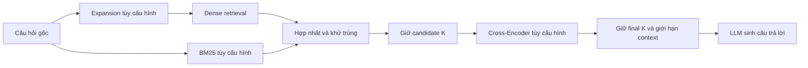

# Kế hoạch cải thiện retrieval, chạy benchmark và báo cáo

Ngày lập: 20/10/2026. Mã nguồn khảo sát: commit `d324ea1`.

**Cập nhật phạm vi theo yêu cầu người dùng ngày 20/10/2026:** chỉ triển khai và benchmark retrieval/reranking. Không cần sinh câu trả lời, judge LLM hoặc Gemini key; các mục end-to-end/generation bên dưới được hoãn khỏi đợt này. Benchmark dùng profile embedding local được ghi rõ, không đồng nhất với baseline Gemini chưa đo.

**Điều chỉnh theo preflight CPU:** BGE reranker int8/256 token đã chạy thật 3 cặp trong khoảng 3,4 giây inference, peak process RSS khoảng 1,9 GiB. Ma trận đầy đủ trên máy hiện tại dùng profile `cpu_bge_mmarco` (giữ BGE-M3 embedding, dùng Cross-Encoder mMARCO MiniLM/512 token); BGE reranker được đo riêng trên dev. Hai profile có model/precision/token budget riêng và không được gộp kết quả. Bản BGE đầy đủ vẫn có config/runner để tái chạy trên thiết bị phù hợp.

**Trạng thái cập nhật:** đã triển khai, chạy benchmark retrieval và lưu raw artifacts; xem [báo cáo thực nghiệm 20/10/2026](../docs/benchmarks/BAO_CAO_RETRIEVAL_2026-10-20.md). Các giai đoạn bên dưới là kế hoạch gốc; dữ liệu hiện là pilot do agent đối chiếu nguồn, chưa có thẩm định độc lập. Generation/judge được loại khỏi phạm vi theo yêu cầu người dùng. Profile full test là BGE-M3 + MiniLM; BGE reranker được đo riêng trên dev do chi phí CPU.

## 1. Mục tiêu và phạm vi

Áp dụng pipeline hai giai đoạn trong PDF người dùng cung cấp: lấy tập ứng viên có recall tốt, sau đó dùng Cross-Encoder xếp hạng lại để chọn context cho RAG. Cần trả lời bằng số liệu:

1. Cross-Encoder cải thiện Hit@5, MRR@5 và nDCG@5 bao nhiêu trên dữ liệu TLU?
2. Dense + BM25 + RRF có giảm số câu bị bỏ sót ở giai đoạn lấy ứng viên không?
3. Mức cải thiện có xứng với độ trễ, RAM/VRAM và chi phí vận hành không?

Triển khai trước ở `services/rag-api`, là backend của luồng remote RAG hiện tại. Giữ ChromaDB để cô lập tác động thuật toán. Qdrant trong PDF là một lựa chọn lưu vector, không phải điều kiện để dùng reranker. Flutter local có pipeline khác, cần một benchmark riêng nếu mở rộng sau này.

Ưu tiên: chuẩn hóa dữ liệu/đánh giá → Cross-Encoder → ablation hybrid → tối ưu inference. BGE-M3 và query expansion là thí nghiệm mở rộng, không đổi đồng thời với reranker trong so sánh chính.

## 2. Hiện trạng và các việc phải sửa trước

| Phát hiện đã xác minh | Bằng chứng trong repository | Việc cần làm |
|---|---|---|
| Backend có semantic/fixed chunking, Gemini embedding, Chroma cosine | `app/rag.py`: `chunk_text`, `get_collection`, `ingest_bytes` | Đóng băng semantic chunking cho thí nghiệm chính |
| Đã có dense và BM25 + weighted RRF; chưa có Cross-Encoder | `app/rag.py`: `_rrf_fuse`, `retrieve_context` | Tái sử dụng hybrid, bổ sung reranker |
| `TOP_K=8` là số lấy cho mỗi query; kết quả có thể tới `MAX_CONTEXT=12` | `app/rag.py:595`, `:610`, `:639` | Tách số ứng viên và số context cuối cùng |
| BM25 import ngay khi khởi động nhưng thiếu dependency trong requirements | `app/bm25_index.py:9`, `app/rag.py:35` | Khai báo `rank-bm25`, xác minh cài đặt sạch |
| Eval có 50 câu: 23 direct, 12 reasoning, 9 abbreviation, 6 out-of-scope | `eval/eval_set.jsonl` | Audit lại cả câu hỏi, đáp án và evidence |
| Bộ light 12 câu là tập con của 50 câu | `eval/eval_set_light.jsonl` | Chỉ dùng smoke test, không coi là test độc lập |
| Q05/Q14/Q17 có đáp án hoặc giả định “10 tín chỉ”, corpus ghi học kỳ chính tối thiểu 15, tối đa 24 kèm ngoại lệ | `eval/eval_set.jsonl`; corpus dòng 545–547 | Sửa theo đúng nguồn và điều kiện áp dụng; phân biệt học phần với tín chỉ; lưu lịch sử sửa nhãn |
| Relevance hiện chỉ cần trùng một từ dài hơn 3 ký tự trong heading | `eval/run_eval.py:213` | Thay bằng qrels được kiểm tra theo chunk/evidence |
| IDCG hiện giả định chỉ có một chunk liên quan, nDCG có thể vượt 1 | `eval/run_eval.py:269` | Tính IDCG từ toàn bộ nhãn liên quan đã xác nhận |
| OOS bị tính 0 chung vào trung bình retrieval | `eval/run_eval.py:236`, `:621` | Tách retrieval trên câu có đáp án khỏi đánh giá từ chối |
| Eval nhánh Gemini lấy context rồi generation lại gọi retrieval lần nữa | `eval/run_eval.py:528`, `:546` | Truyền đúng `context`/`sources` đã đo vào `stream_answer` |
| Ablation đổi `CHUNK_MODE` nhưng không đổi/rebuild collection | `eval/run_eval.py:826`; `app/rag.py:264` | Mỗi kiểu chunking phải có index riêng; giữ cố định chunking trong vòng chính |
| ID tài liệu thay đổi sau mỗi ingest; checkpoint chưa bao gồm hash dữ liệu/mô hình | `app/rag.py:460`; `eval/run_eval.py:137` | Snapshot index, ánh xạ ID ổn định và định danh run đầy đủ |
| Kết quả đang lưu là `ablation_placeholder.md`, có nhãn `[RUN REQUIRED]` | `eval/results/ablation_placeholder.md:2` | Không dùng các số này làm baseline thực nghiệm |

Các đường dẫn `app/` và `eval/` trong bảng thuộc `services/rag-api/`. Một số kết luận trong `docs/BAO_CAO_KY_THUAT_RAG.md` lặp lại số trong placeholder; chỉ cập nhật sau khi có artifacts xác minh được.

## 3. Áp dụng và kiểm tra nội dung PDF

- Trang 8–9, 13–17: retrieve ứng viên rồi rerank theo cặp `(câu hỏi gốc, chunk)`; điểm khởi đầu là lấy 20, giữ 5.
- Trang 20–22: reranker không khôi phục được evidence chưa lọt tập ứng viên. Phải đo cả candidate recall và chất lượng thứ hạng cuối.
- Trang 21–22: nhiều chunk tương đương có thể làm nhãn một `doc_id` đánh giá sai chất lượng. Cần nhiều nhãn đúng và nhóm evidence tương đương.
- Trang 22–25: benchmark batch size, giới hạn token và thời gian từng giai đoạn; không lấy bảng VRAM ước lượng làm cam kết phần cứng.

**Điểm cần làm rõ khi tái sử dụng số liệu PDF:** trang 21 mô tả MRR theo top-5, nhưng tính lại từ bảng rank trang 20 cho thấy:

| Chỉ số tính lại từ 10 câu của PDF | Trước rerank | Sau rerank |
|---|---:|---:|
| Hit@5 | 0.4000 | 0.5000 |
| MRR@5 | 0.1733 | 0.2950 |
| MRR@20 | 0.1971 | 0.3075 |

Hai số MRR khoảng 0.197 và 0.308 được PDF nêu khớp với cutoff 20. Benchmark TLU phải ghi rõ cutoff, không dùng tên MRR chung chung. Đây là kiểm tra phép tính trên dữ liệu bài viết, không phải kết quả đo của project TLU.

## 4. Thiết kế thuật toán và điểm tích hợp



### 4.1. Cross-Encoder reranking — phần triển khai chính

- Tạo `app/reranker.py`, dùng `sentence_transformers.CrossEncoder` với `BAAI/bge-reranker-v2-m3`. Model card chính thức có ví dụ dùng thư viện này và mô tả khả năng đa ngôn ngữ; chất lượng tiếng Việt TLU phải tự đo. [Model card BAAI](https://huggingface.co/BAAI/bge-reranker-v2-m3).
- Load mô hình một lần cho mỗi process; chỉ load khi bật rerank. Khóa model revision, phiên bản thư viện, device và precision trong manifest.
- Chấm cả danh sách cặp theo batch, giữ `chunk_id`, metadata, điểm retrieval, điểm rerank và rank trước/sau. Không cộng trực tiếp cosine, BM25, RRF và logits.
- Rerank trước khi cắt xuống `FINAL_K`; ràng buộc `0 < FINAL_K <= CANDIDATE_K`. Không lấy 12 chunk đã cắt rồi gọi đó là rerank top-20.
- Khởi đầu `CANDIDATE_K=20`, `FINAL_K=5`, `max_length=512`; đây là cấu hình thí nghiệm, không phải khẳng định tối ưu. Đo tỷ lệ input bị truncation, đặc biệt bảng và câu hỏi nhiều điều kiện.
- CPU thử batch 1/2; GPU thử 4/8/16 sau khi kiểm tra bộ nhớ. Chọn batch bằng phép đo trên dev. [Tham số CrossEncoder](https://www.sbert.net/docs/package_reference/cross_encoder/model.html).
- Sắp xếp tie theo ID ổn định. Khi rỗng trả danh sách rỗng. Production có thể fallback về thứ hạng retrieval khi inference lỗi; benchmark phải đánh dấu fallback, lỗi và độ phủ, không tính fallback như lần rerank thành công.
- Giữ hành vi cũ khi tắt rerank; thêm metadata stage timings/score types theo cách tương thích với SSE client hiện tại.

### 4.2. Hybrid retrieval — tái sử dụng và đo phần đóng góp

- Bổ sung BM25-only mode vì code hiện luôn chạy dense trước.
- Dùng RRF đã có, khởi đầu `BM25_WEIGHT=0.3`, hằng số RRF 60. Chỉ tune trọng số trên dev.
- Với thí nghiệm chính: dense tối đa K ứng viên, BM25 tối đa K ứng viên; hybrid hợp nhất tối đa 2K rồi giữ K. Ghi cả ngân sách mỗi nhánh và số ID duy nhất sau hợp nhất.
- So sánh có/không rerank phải dùng đúng cùng candidate pool. So sánh hybrid với dense phải công bố thêm chi phí của nhánh lexical, tránh quy toàn bộ lợi ích cho công thức fusion.
- Thống nhất khử trùng theo ID/evidence và cách gộp điểm giữa các query. Nếu sửa lỗi giữ điểm ở lần xuất hiện đầu tiên thành lấy điểm tốt nhất, áp dụng cho mọi cấu hình kiểm soát và ghi riêng so với baseline nguyên trạng.

### 4.3. BGE-M3 — mở rộng sau benchmark chính

- Thử `BAAI/bge-m3` nếu cần nhánh local embedding theo PDF. Model card công bố vector 1024 chiều; phải encode lại cả corpus và query bằng cùng model/revision vào index riêng. [Model card BGE-M3](https://huggingface.co/BAAI/bge-m3).
- Không trộn vector Gemini với BGE-M3, kể cả khi có cùng số chiều. Đổi embedding là một ablation riêng, có chi phí indexing riêng.
- Muốn chạy hoàn toàn offline phải tắt expansion dùng Gemini hoặc thay bằng biến thể cố định đã lưu; chỉ dùng reranker local chưa khiến pipeline hiện tại chạy offline.
- Query expansion, tokenizer tiếng Việt hoặc mô hình nhỏ hơn chỉ bổ sung thành cấu hình riêng sau khi baseline chính ổn định. Chưa cần fine-tune trong vòng thực nghiệm đầu.

## 5. Dữ liệu benchmark và nhãn chuẩn

**Corpus:** đóng băng `output_md/guide_book_k38_pymupdf.md`, SHA-256, cấu hình chunking, chunk texts, metadata và index. Ghi số chunk thực tế sau khi dựng, không lấy số ước lượng trong báo cáo cũ. Mỗi thay đổi chunking tạo corpus version và qrels mapping riêng.

**Bộ câu hỏi đề xuất:**

- Dev: 50 câu hiện có sau khi audit; 12 câu light chỉ là smoke subset của dev.
- Test: thêm 100 câu chưa dùng để tune, mục tiêu 80 câu có đáp án và 20 câu ngoài phạm vi. Bao phủ hỏi trực tiếp, tình huống/suy luận, viết tắt, số liệu, bảng, nhiều điều kiện và cần nhiều evidence. Các nhãn nhóm có thể giao nhau.
- Tách theo nhóm ý định/đáp án, giữ các paraphrase cùng nhóm trong cùng split. Không đưa biến thể của câu dev sang test rồi gọi đó là test độc lập.
- Test chỉ chạy sau khi khóa cấu hình. Nếu sửa lỗi nhãn khi đã xem kết quả, tăng version, công bố sửa đổi và chạy lại các baseline liên quan.
- Nếu chỉ dùng 50 câu cũ, phải báo cáo là thí nghiệm thăm dò; không dùng chúng đồng thời để tune và chứng minh khả năng tổng quát hóa.

**Schema dự kiến, không phải dữ liệu đã được gán nhãn:**

```json
{"query_id":"DEV_Q01","question":"...","split":"dev","category":"direct","answerable":true,"intent_group":"...","required_evidence_groups":["E01"]}
{"query_id":"DEV_Q01","chunk_id":"k38-v1:...","relevance":2,"evidence_group_id":"E01","source_span":"...","rationale":"..."}
```

- Qrels có nhãn 0 = không liên quan, 1 = liên quan nhưng chưa đủ trả lời, 2 = chứa evidence trả lời. Nhóm evidence gộp các chunk có thể thay thế nhau; evidence cần kết hợp phải ở các nhóm khác nhau.
- Chunk ID benchmark ổn định từ source hash, chunking version, vị trí và content hash; lưu mapping sang ID trong snapshot Chroma. Không phụ thuộc UUID mới mỗi lần ingest.
- Người gán nhãn kiểm tra nguồn, điều kiện/khóa/ngành/học kỳ và các con số. Rà soát chéo ít nhất 20% và toàn bộ trường hợp mâu thuẫn hoặc reasoning.
- Tạo judgment pool từ nhiều retriever trên dev và các cấu hình đã khóa trên test; gán nhãn khi ẩn tên hệ thống/rank. Không điều chỉnh thuật toán từ kết quả test.
- Tìm gold evidence từ corpus ngoài judgment pool để giảm bỏ sót. Không mặc nhiên biến chunk chưa chấm thành nhãn 0. Ghi tỷ lệ chưa chấm; nếu qrels chưa đầy đủ, gọi recall là recall trên nhãn đã biết và nêu hạn chế.

## 6. Ma trận thí nghiệm

Các cấu hình A–E dùng cùng corpus semantic, embedding, câu hỏi, `CANDIDATE_K=20`, `FINAL_K=5`, tắt expansion trong so sánh chính.

| ID | Giai đoạn lấy ứng viên | Rerank | So sánh chính |
|---|---|---|---|
| L0 | Pipeline nguyên trạng, expansion bật, TOP_K=8, MAX_CONTEXT=12 | Không | Tham chiếu hành vi cũ, báo riêng vì ngân sách context khác |
| A | Dense | Không | Baseline kiểm soát |
| B | BM25 | Không | Baseline lexical |
| C | Dense + BM25 + weighted RRF | Không | C so với A/B: đóng góp hybrid |
| D | Dense, cùng candidate pool với A | Cross-Encoder | D so với A: đóng góp reranker |
| E | Hybrid, cùng candidate pool với C | Cross-Encoder | E so với C: đóng góp reranker trên hybrid |
| F, tùy chọn | Cấu hình tốt trên dev + expansion | Theo cấu hình | Đóng góp expansion, không trộn vào hiệu ứng riêng của rerank |

Chỉ sweep trên dev: candidate K 10/20/50; BM25 weight 0.2/0.3/0.5; max length 256/512; batch theo thiết bị. Tune từng nhóm tham số, không chạy tích Descartes tất cả lựa chọn. Đảm bảo cùng giới hạn context/token khi so sánh câu trả lời end-to-end.

Vòng test bắt buộc có A–E với cấu hình đã khóa; L0 và F báo riêng nếu chạy. Cặp A/D, C/E dùng chung candidate cache cho đánh giá chất lượng. Cached replay chỉ đo inference/ranking, không thay thế độ trễ live của hệ thống.

## 7. Chỉ số và quy tắc tính

| Nhóm | Chỉ số và cách dùng |
|---|---|
| Khả năng tìm evidence | Candidate Hit@K; Recall@K trên toàn bộ gold evidence đã xác nhận, với K 10/20/50 khi sweep |
| Chất lượng cuối | Hit@1/3/5, MRR@5, nDCG@5, Precision@5, Recall@5; nDCG@5 là chỉ số chọn cấu hình chính |
| Nhiều evidence/trùng lặp | Coverage các evidence group cần thiết, tỷ lệ đủ tất cả nhóm; báo thêm kết quả sau gộp nhóm tương đương |
| Hệ thống | p50/p95 và trung bình cho expansion, embedding, search, fusion, rerank, total retrieval; cold start, throughput, peak RAM/VRAM, lỗi/fallback |
| End-to-end | Faithfulness, answer relevance/correctness, OOS refusal rate, false refusal trên câu có đáp án, TTFT và total answer latency |
| Chi phí | Indexing, query embedding, expansion, generation/judge và tài nguyên inference tách riêng; lấy usage và đơn giá tại thời điểm chạy |

Quy ước bắt buộc:

1. Retrieval metrics chỉ tính trên câu `answerable=true`. OOS ghi N/A cho các metric này, không chèn số 0 vào mẫu số. Báo rõ số câu/mẫu số từng nhóm.
2. Binary relevance cho Hit/MRR/Precision/Recall là grade 2; grade 1 chỉ cung cấp liên quan một phần. nDCG dùng gain `2^grade - 1`, IDCG từ gold grades sắp giảm dần và cắt tại k.
3. `MRR@k = mean(1/rank_first_relevant)` nếu rank không vượt k, ngược lại bằng 0. `Precision@k` chia cho k, vị trí thiếu coi là không liên quan. Nếu không có gold relevant thì trả N/A và điều tra nhãn.
4. nDCG phải nằm trong [0,1]; tie-break, dedup và qrels version cố định. Nếu dùng evaluator có tùy chọn tự thêm positive, phải tắt để đánh giá candidate recall thực tế. [Tài liệu evaluator](https://www.sbert.net/docs/package_reference/cross_encoder/evaluation.html).
5. Phân tích toàn bộ câu answerable, gồm cả câu mất evidence ngay ở stage 1; không chỉ báo kết quả trên các câu reranker có thể cứu.
6. So sánh theo cặp query ID: bootstrap 95% CI của chênh lệch nDCG/MRR, seed cố định; exact McNemar cho Hit khi số cặp bất đồng nhỏ. Resample theo intent group nếu còn các câu phụ thuộc nhau.
7. Độ trễ: tối thiểu 3 lượt đo sau warmup trên cùng thiết bị, đổi thứ tự cấu hình, công bố concurrency và trạng thái cache. Cold start đo riêng. Các lượt lặp không làm tăng số câu độc lập trong CI chất lượng.
8. Không lấy word count làm số token tính tiền, không ghi inference local là miễn phí, không tái dùng công thức chi phí ước lượng cũ như hóa đơn thực tế. Nếu thiếu usage thì ghi chưa đo.

End-to-end chỉ chạy baseline A, baseline hybrid C và cấu hình được chọn trên dev để giảm chi phí. Giữ cùng LLM, prompt, ngày trong prompt, nhiệt độ, số token context/output và judge; generation đọc đúng context đã chấm retrieval. Lưu context/câu trả lời đầy đủ và rubric, không chỉ bản preview bị cắt như harness cũ. Judge phải nhận đủ evidence đã dùng để trả lời hoặc công bố rõ phần bị cắt. Review thủ công mẫu câu bất đồng; judge không thay cho nhãn retrieval chuẩn.

Rerank không tự cung cấp cơ chế từ chối OOS. Vòng chính đánh giá từ chối của toàn hệ thống; nếu bổ sung ngưỡng score thì đó là cấu hình riêng, hiệu chỉnh trên dev và khóa trước test. Không coi sigmoid score là xác suất answerable đã được hiệu chuẩn. Sửa điều kiện nhận diện false refusal bị đảo trong `eval/error_analysis.py` trước khi tái sử dụng script này.

## 8. Môi trường, benchmark runner và artifacts

Môi trường được kiểm tra: Python 3.12.3; Intel Core i3-5010U, 2 nhân/4 luồng; khoảng 7.7 GiB RAM, khoảng 2.3 GiB khả dụng tại thời điểm kiểm tra; Intel HD Graphics 5500, không thấy công cụ/GPU NVIDIA. Repo mới clone chưa có `.env`, runtime index hoặc các package RAG/torch trong Python đang dùng.

- Máy hiện tại: tạo venv riêng, kiểm tra dependency, audit dữ liệu, test metric và smoke BM25; chỉ thử Cross-Encoder sau khi đo nhu cầu RAM và thời gian trên mẫu nhỏ.
- Benchmark đầy đủ: ưu tiên máy có GPU và đủ RAM, hoặc CPU server đủ tài nguyên. Chọn môi trường cụ thể sau smoke; không giả định FP16 trên CPU, không tự cài driver hoặc thuê GPU trong bước lập kế hoạch.
- Nhánh Gemini cần API key, model khả dụng và quota. Nhánh local cần tải weights một lần và index riêng. Không hard-code phiên bản thư viện từ PDF; kiểm tra giải dependency với requirements hiện có rồi khóa bộ phiên bản chạy thành công.
- Không tái ingest hoặc ghi đè dữ liệu production để benchmark. Dùng thư mục Chroma/sources riêng theo corpus version và embedding model.

Các file dự kiến triển khai:

| File | Trách nhiệm |
|---|---|
| `services/rag-api/requirements.txt`, file dependency/lock rerank riêng | Sửa thiếu BM25, tách bộ inference nặng khi tắt reranker |
| `services/rag-api/app/reranker.py` | Khởi tạo model, batch scoring, sắp hạng và xử lý lỗi |
| `services/rag-api/app/rag.py`, `app/main.py` | Tách candidates/final context, sparse mode, cấu hình và telemetry |
| `services/rag-api/eval/build_retrieval_dataset.py` | Snapshot corpus, IDs và validation queries/qrels |
| `services/rag-api/eval/retrieval_metrics.py` | Metrics có cutoff và nhãn chuẩn |
| `services/rag-api/eval/run_retrieval_benchmark.py` | Chỉ retrieval; độc lập generation/judge; candidate cache và live timing |
| `services/rag-api/eval/benchmark_configs.json` | A–E và cấu hình đã khóa, tránh env/checkpoint bị lẫn |
| `services/rag-api/eval/report_retrieval_benchmark.py` | Tổng hợp, CI, bảng/biểu đồ và error analysis |
| `services/rag-api/eval/run_eval.py`, `eval/stats.py` | Sửa double retrieval, metrics/OOS và thống kê theo cặp |
| `services/rag-api/eval/datasets/retrieval_v1/` | Queries, qrels, corpus/split manifest và lịch sử sửa nhãn |

Mỗi run lưu tại `data/benchmarks/reranking/<run_id>/`: `manifest.json`, `candidates.jsonl`, `rankings.jsonl`, `per_query.csv`, `summary.json`, `latency.csv`, `errors.jsonl`, `comparison.json` và biểu đồ PNG/SVG. Manifest gồm commit, config hash, corpus/qrels/split hashes, model revisions, dependency versions, hardware, seed, thời điểm, K/batch/token budgets, cache mode, số câu dự kiến/thành công/lỗi.

`data/` và nhiều kết quả eval hiện bị gitignore. Khi hoàn tất, xuất báo cáo vào `docs/benchmarks/` cùng manifest và bảng tổng hợp được chọn, đảm bảo số liệu trích dẫn có artifacts truy nguyên được. Không commit API key, cache weights hoặc database runtime.

Định danh checkpoint phải bao gồm config/corpus/qrels/model hashes. Không tái dùng checkpoint cũ chỉ vì cùng top-k. Mỗi run xác minh đủ query ID, không trùng/thiếu ID và không âm thầm loại các lỗi để tăng điểm.

Luồng CLI dưới đây là **giao diện đề xuất để triển khai**, các script mới và file cấu hình locked chưa tồn tại:

```bash
# Từ repository root, sau khi đã cài dependency, dựng corpus và gán nhãn.
python services/rag-api/eval/run_retrieval_benchmark.py --validate-data
python services/rag-api/eval/run_retrieval_benchmark.py --split dev --smoke
python services/rag-api/eval/run_retrieval_benchmark.py --split dev --configs A,B,C,D,E
# Chỉ tạo locked config sau khi kết thúc tune trên dev.
python services/rag-api/eval/run_retrieval_benchmark.py --split test --locked-config data/benchmarks/reranking/locked_config.json
python services/rag-api/eval/report_retrieval_benchmark.py --run-dir data/benchmarks/reranking/TEST_RUN_ID
```

Runner cần từ chối chế độ test nếu config chưa khóa hoặc hashes không khớp; phần gán nhãn và xác nhận split không được script tự tạo thành nhãn chuẩn bằng heuristic.

## 9. Thứ tự thực hiện và điều kiện hoàn thành

| Giai đoạn | Công việc | Đầu ra/điều kiện chuyển bước | Công sức dự kiến |
|---|---|---|---|
| 0 | Chụp baseline code/config, cài venv và sửa dependency | Import sạch; corpus và môi trường có manifest | 0.5 ngày |
| 1 | Audit 50 câu, tạo qrels, bổ sung test và kiểm tra chéo | Nhãn có nguồn; dev/test không trùng intent; ID ổn định | 1.5–2 ngày |
| 2 | Tách candidate/final K; thêm reranker và sparse mode | Rerank đúng pool, giữ metadata; tắt rerank vẫn chạy được | 1 ngày |
| 3 | Viết metrics/runner/export và sửa eval end-to-end | Test metric chuẩn; smoke 12 câu xuất đủ artifacts | 1 ngày |
| 4 | Chạy A–E trên dev, tune có giới hạn | Chọn cấu hình và ngân sách latency trước khi mở test | 0.5–1 ngày, cộng thời gian máy chạy |
| 5 | Khóa cấu hình, chạy test và end-to-end chọn lọc | Có baseline ghép cặp, coverage/lỗi và CI | 0.5 ngày, cộng thời gian máy chạy |
| 6 | Phân tích lỗi, làm biểu đồ, viết báo cáo | Kết luận dẫn được tới run/artifacts cụ thể | 0.5–1 ngày |

Tổng ước lượng khoảng **6–8 ngày công**, phụ thuộc khối lượng gán nhãn và tài nguyên inference; chưa bao gồm thời gian chờ quota/GPU. Đo thử trước để dự báo runtime. Với test 100 câu và A–E: có 500 cặp query–cấu hình cho một lượt chất lượng; nếu K=20, D/E có tối đa 4.000 cặp query–chunk để rerank. Các lượt đo độ trễ lặp lại tính riêng. Chưa sinh/judge câu trả lời ở vòng retrieval-only.

Các kiểm tra có ý nghĩa phải có trước benchmark đầy đủ:

- Metrics với gold tính tay: rank 1/rank 3/vắng mặt, nhiều positive, graded labels, OOS, thiếu kết quả, chunk trùng và nDCG <= 1.
- Rerank không được tạo ID mới ngoài pool; score/rank gắn đúng chunk sau batching, giữ nguyên doc filter; xử lý pool rỗng/lỗi model rõ ràng.
- A/D và C/E khớp hash candidate pool; rerank bật/tắt có cùng final K; generation chỉ retrieval một lần và dùng đúng context.
- Corpus, qrels, query split và index embedding model khớp manifest; timeout/OOM/quota có trạng thái và checkpoint khôi phục được.

## 10. Chọn cấu hình và nội dung báo cáo

Chọn ứng viên trên dev bằng nDCG@5, sau đó xem Hit/MRR, evidence coverage và latency. Chốt ngân sách p95 trên phần cứng mục tiêu sau smoke và trước test, thay vì áp một số ms chưa đo. Mức cải thiện từ 0.03 nDCG tuyệt đối có thể dùng làm ngưỡng thực tiễn ban đầu, nhưng phải khóa ngưỡng trước test và báo CI; không phải kết quả được hứa hẹn.

Chỉ khuyến nghị bật mặc định khi test cho thấy lợi ích đủ rõ trong ngân sách vận hành và không làm giảm đáng kể evidence coverage hoặc tăng từ chối sai. Nếu CI rộng hoặc đi qua 0, kết luận chưa đủ bằng chứng; nếu rerank kém hơn, báo đúng kết quả và giữ cấu hình baseline phù hợp.

Báo cáo hoàn chỉnh dùng [mẫu báo cáo](../docs/MAU_BAO_CAO_RERANKING.md), gồm:

1. Corpus, nhãn, split, thiết bị, mô hình, protocol và sửa lỗi đánh giá.
2. Bảng A–E: candidate recall, Hit@5, MRR@5, nDCG@5, p50/p95, bộ nhớ, coverage/lỗi.
3. Chênh lệch D−A, E−C, C−A; CI 95%; phân tích theo loại câu và đủ evidence.
4. Biểu đồ chất lượng–độ trễ, recall theo candidate K, thời gian từng giai đoạn; mỗi biểu đồ chỉ dùng dữ liệu chạy thật.
5. Case study trước/sau: được cải thiện, bị giảm hạng, không có gold trong candidate pool, chunk tương đương, input bị cắt và câu ngoài phạm vi.
6. Kết quả end-to-end, chi phí có nguồn, hạn chế và cấu hình khuyến nghị.

**Hoàn thành vòng triển khai** khi có mã chạy lại được, nhãn đã audit, artifacts đủ đối chiếu baseline, báo cáo từ số liệu thật và kết luận có phạm vi. Không yêu cầu reranker phải thắng để coi thí nghiệm là hoàn thành.

## 11. Tài liệu đối chiếu

- PDF người dùng cung cấp: `#17 - Reranking và đánh giá retrieval_1.pdf`, 27 trang; trọng tâm trang 8–9, 13–17, 20–25.
- [Retrieve & Re-Rank — Sentence Transformers](https://sbert.net/examples/sentence_transformer/applications/retrieve_rerank/README.html): kiến trúc hai giai đoạn.
- [BAAI/bge-reranker-v2-m3](https://huggingface.co/BAAI/bge-reranker-v2-m3): model card và cách inference.
- [CrossEncoder API](https://www.sbert.net/docs/package_reference/cross_encoder/model.html): batching, max length và tham số inference.
- [CrossEncoder evaluation](https://www.sbert.net/docs/package_reference/cross_encoder/evaluation.html): evaluator và giới hạn candidate pool.
- [BAAI/bge-m3](https://huggingface.co/BAAI/bge-m3): embedding model cho thí nghiệm mở rộng.

Các nguồn online được đối chiếu khi lập kế hoạch; cần xác minh và khóa lại phiên bản thực tế khi triển khai.
