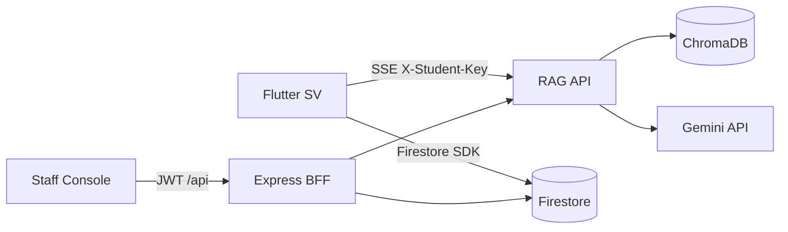
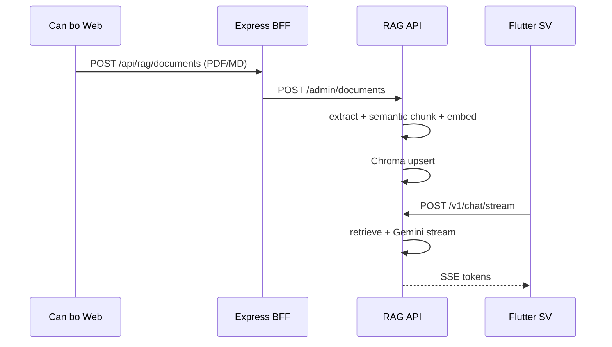
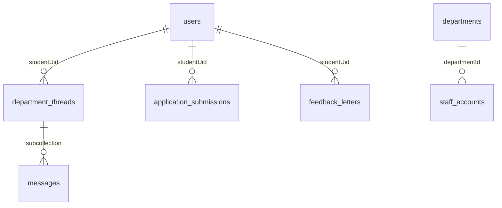

# Mô tả kỹ thuật dự án — TLU AI Assistant

Tài liệu mô tả monorepo [`Graduation_Thesis`](/Users/huan/Documents/Graduation_Thesis) để gửi Claude viết khóa luận.

**Sản phẩm:** Trợ lý AI + kênh tương tác sinh viên ↔ phòng ban (Đại học Thăng Long).

---

## 1. Mục tiêu hệ thống

**Sinh viên (Flutter):** Hỏi đáp theo tài liệu trường (RAG qua server), STT/TTS tiếng Việt, chat phòng ban, thông báo, nộp đơn, góp ý, mở cổng học vụ (WebView).

**Cán bộ (Staff Console):** Quản lý SV, trả lời chat, phát thông báo (FCM), xem đơn/góp ý, upload tài liệu RAG, phân quyền cán bộ, audit.

| Thành phần | Stack | Vai trò |
|------------|-------|---------|
| App SV | Flutter `tlu_ai_assistant` | Client mobile |
| Web cán bộ | React + Vite + Tailwind | UI `apps/staff-console` |
| BFF | Express `server/index.mjs` | JWT, Firestore Admin, proxy RAG, FCM |
| RAG API | FastAPI + Chroma + Gemini | Ingest + retrieve + chat SSE |
| DB nghiệp vụ | Firestore | Chat, thông báo, đơn, hồ sơ |
| File | Firebase Storage | Đính kèm đơn |
| Push | FCM | Broadcast + thông báo chat |
| Deploy | Docker Compose | `rag-api:8080`, `staff-console:3000` |

---

## 2. Kiến trúc

**Phân tầng dữ liệu:**
- **Firestore** — chat phòng ban, thông báo, đơn, góp ý, `users`.
- **Chroma** — vector tài liệu (.md / .txt / .pdf sau extract); không lưu vector trong Firestore.
- **Flutter** — không index/embed tài liệu; chỉ gọi `POST /v1/chat/stream` ([`remote_rag_service.dart`](/Users/huan/Documents/Graduation_Thesis/lib/services/remote_rag_service.dart)).

**Cổng:** RAG `http://127.0.0.1:8080` (emulator Android: `10.0.2.2:8080`); staff Docker `http://127.0.0.1:3000`. Cấu hình: [`.env.example`](/Users/huan/Documents/Graduation_Thesis/.env.example), [`docker-compose.yml`](/Users/huan/Documents/Graduation_Thesis/docker-compose.yml).

---

## 3. RAG server — chiến lược cốt lõi

Tham chiếu thiết kế: [`plans/RAG_STRATEGY_MD.md`](/Users/huan/Documents/Graduation_Thesis/plans/RAG_STRATEGY_MD.md).  
Tham chiếu triển khai mẫu (Dart): [`lib/services/pdf_service.dart`](/Users/huan/Documents/Graduation_Thesis/lib/services/pdf_service.dart) — **logic này được deploy y hệt lên `services/rag-api`**, không chạy RAG trên thiết bị.

### 3.1 Vì sao không cắt cố định theo ký tự?

Sổ tay/quy chế Markdown có bảng biểu, danh sách, tiêu đề phòng ban. Cắt sliding window thuần (ví dụ 900 ký tự) dễ cắt ngang bảng và mất ngữ cảnh tiêu đề → LLM trả lời sai quy định/lịch học.

### 3.2 Semantic Markdown Chunking (pipeline ingest)

| Bước | Mô tả | Tham số (pdf_service / STRATEGY) |
|------|--------|----------------------------------|
| 1. Extract | Đọc `.md`, `.txt`; PDF qua PyMuPDF (`rag.py`) | UTF-8 |
| 2. Heading split | Chia theo `##` (và `#`) — mỗi section = một đơn vị ngữ nghĩa | Theo cấu trúc MD |
| 3. Context enrichment | Chunk mang tiêu đề cha: `heading + content` | Tránh chunk “mồ côi” |
| 4. Table/list guard | Không cắt giữa block `\|...\|`; section dài mới sub-split | `_maxChunkSize` ≈ **1200** ký tự |
| 5. Fallback | Section > ngưỡng → chia theo đoạn + overlap **~150** ký tự (3 dòng cuối) | Chỉ khi quá dài |
| 6. Embed | Gemini REST `gemini-embedding-001` | 1 request/chunk, retry 429 |
| 7. Store | Chroma collection `tlu_docs`, cosine | metadata: `doc_id`, `doc_name`, `heading_path`, `chunk_index`, `chunk_type` |
| 8. Query | Embed câu hỏi → top-**k** (8) → prompt + Gemini Flash stream | SSE `/v1/chat/stream` |

### 3.3 Luồng vận hành

**Upload:** Cán bộ — trang `/vectors` → BFF proxy → `rag-api` (`X-Admin-Key`).  
**Hỏi đáp:** Sinh viên — `RemoteRagService` + `X-Student-Key`; UI [`ChatProvider`](/Users/huan/Documents/Graduation_Thesis/lib/providers/chat_provider.dart) + [`chat_screen.dart`](/Users/huan/Documents/Graduation_Thesis/lib/screens/chat_screen.dart).

**Ghi chú repo:** `rag-api/app/rag.py` hiện còn `chunk_text()` sliding 900/120; mục tiêu triển khai là thay bằng module semantic tương đương `pdf_service.dart` (todo `port-chunking`).

---

## 4. Ứng dụng Flutter (sinh viên)

**Cấu trúc:** `lib/{config, models, providers, screens, services, widgets}` — entry [`main.dart`](/Users/huan/Documents/Graduation_Thesis/lib/main.dart).

| Nhóm | Màn hình / service | Ghi chú |
|------|-------------------|---------|
| AI chat | `chat_screen`, `ChatProvider`, `remote_rag_service` | Chỉ RAG server; STT/TTS |
| Chat phòng ban | `department_chat_screen`, `department_chat_repository` | Thread `{uid}_{deptId}`; 5 dept trong `department_catalog.dart` |
| Thông báo | `notifications_screen` | `school_notifications` + FCM topic `school_broadcast` |
| Đơn / góp ý | `application_form_screen`, `feedback_letter_screen` | Storage + Firestore |
| Web học vụ | `school_webview_screen` | URL trong `school_web_config.dart` |
| Auth | `firebase_session_service`, `school_auth_service` | Anonymous (demo) hoặc Google `@thanglong.edu.vn` |

**`--dart-define`:** `API_BASE_URL`, `STUDENT_API_KEY` — [`api_config.dart`](/Users/huan/Documents/Graduation_Thesis/lib/config/api_config.dart).

**Demo:** `DemoReportConfig.enabled` tắt Firebase, dùng data giả — chỉ cho screenshot; production bật Firebase thật.

**Không lưu Firestore:** hội thoại AI (chỉ state in-memory `ChatProvider`).

---

## 5. Staff Console (cán bộ)

**Path:** [`apps/staff-console`](/Users/huan/Documents/Graduation_Thesis/apps/staff-console) — React 18 + Vite, BFF cùng package.

**RBAC:**

| Role | Quyền chính |
|------|-------------|
| `super_admin` | Toàn quyền; CRUD cán bộ, thông báo, sửa hồ sơ SV |
| `staff` | SV, chat, đơn, góp ý, vector RAG |
| `auditor` | Xem SV, thông báo, audit logs |

Routes: `/`, `/students`, `/chat`, `/notifications`, `/submissions`, `/feedback`, `/vectors`, `/audit`, `/settings`, `/login`.  
Auth: `POST /api/auth/staff-login` → JWT 12h → `localStorage`; tài khoản `staff_accounts` (bcrypt), không Firebase Auth cho console.

---

## 6. Backend API (tóm tắt)

**BFF** [`server/index.mjs`](/Users/huan/Documents/Graduation_Thesis/apps/staff-console/server/index.mjs): Firestore Admin, FCM, audit, proxy RAG.

| Nhóm | Endpoint |
|------|----------|
| Auth | `POST /api/auth/staff-login`, `GET /api/auth/me` |
| SV | `GET/PATCH /api/users` |
| Thông báo | `GET/POST/DELETE /api/notifications` |
| Chat | `GET /api/chat/threads`, `GET/POST .../messages` |
| Đơn / góp ý | `GET /api/submissions`, `GET /api/feedback` |
| RAG proxy | `GET/POST/DELETE /api/rag/documents`, `GET /api/rag/ingest-jobs/:id` |
| Cán bộ | `CRUD /api/staff/accounts` (super_admin) |
| Audit | `GET /api/audit-logs` |

**RAG API** [`services/rag-api`](/Users/huan/Documents/Graduation_Thesis/services/rag-api):

| Endpoint | Auth | Mục đích |
|----------|------|----------|
| `POST /admin/documents` | `X-Admin-Key` | Ingest file |
| `GET /admin/ingest-jobs/{id}` | Admin | Trạng thái job |
| `GET/DELETE /admin/documents` | Admin | Danh sách / xóa |
| `POST /v1/chat/stream` | `X-Student-Key` | Chat SSE cho Flutter |

---

## 7. Firestore — mô hình dữ liệu

| Collection | Ai ghi | Mục đích |
|------------|--------|----------|
| `users/{uid}` | Flutter + BFF PATCH | Hồ sơ SV, `fcmToken` |
| `departments/{id}` | BFF seed | 5 phòng ban (read-only client) |
| `staff_accounts/{id}` | BFF only | Login cán bộ |
| `department_threads/{uid}_{dept}` | Flutter / BFF | Metadata chat |
| `.../messages/{id}` | Flutter (`student`), BFF (`staff`) | Tin nhắn |
| `school_notifications` | BFF | Thông báo toàn trường |
| `application_submissions` | Flutter | Đơn + attachments |
| `feedback_letters` | Flutter | Góp ý |
| `audit_logs` | BFF | Nhật ký thao tác |

**Rules:** [`firestore.rules`](/Users/huan/Documents/Graduation_Thesis/firestore.rules) — `isStudentLike()` (email `@thanglong.edu.vn` hoặc anonymous); thread ownership `^{uid}_`; `staff_accounts` deny client.

---

## 8. Luồng tương tác SV ↔ cán bộ

1. **Chat phòng ban:** SV ghi Firestore → BFF đọc/ghi reply staff → FCM (tuỳ chọn) → SV `snapshots()` realtime.
2. **Thông báo:** Super admin POST notification → Firestore + FCM topic `school_broadcast`.
3. **Đơn từ:** Flutter upload Storage → doc `application_submissions` → cán bộ xem `/submissions`.

---

## 9. Bảo mật & hạn chế (cho khóa luận)

- Tách auth SV (Firebase) vs cán bộ (JWT + `staff_accounts`).
- API keys: `STUDENT_API_KEY`, `ADMIN_API_KEY`, `STAFF_API_KEY`.
- Audit log các thao tác nhạy cảm.
- Hạn chế: anonymous auth khi demo; ingest job RAG in-memory (mất khi restart container); cần port xong semantic chunking sang Python.

---

## 10. Gợi ý cấu trúc khóa luận

1. **Chương 1–2:** Bối cảnh TLU, khảo sát nhu cầu.
2. **Chương 3:** Yêu cầu (RAG semantic, chat, thông báo, đơn).
3. **Chương 4:** Kiến trúc (mục 2, 7).
4. **Chương 5:** Chi tiết — **5.1 RAG server (Semantic Markdown Chunking)**, 5.2 Flutter, 5.3 Staff + BFF, 5.4 Firestore/FCM.
5. **Chương 6:** Triển khai Docker/Firebase.
6. **Chương 7:** Kiểm thử ([`docs/E2E_CHECKLIST.md`](/Users/huan/Documents/Graduation_Thesis/docs/E2E_CHECKLIST.md)).
7. **Kết luận:** Tích hợp AI + hành chính số; hướng phát triển (auth SV thật, scale Chroma).

---

## 11. File tham chiếu

| Nội dung | File |
|----------|------|
| Chiến lược RAG | [`plans/RAG_STRATEGY_MD.md`](/Users/huan/Documents/Graduation_Thesis/plans/RAG_STRATEGY_MD.md) |
| Chunking mẫu | [`lib/services/pdf_service.dart`](/Users/huan/Documents/Graduation_Thesis/lib/services/pdf_service.dart) |
| RAG server | [`services/rag-api/app/rag.py`](/Users/huan/Documents/Graduation_Thesis/services/rag-api/app/rag.py) |
| Flutter RAG client | [`lib/services/remote_rag_service.dart`](/Users/huan/Documents/Graduation_Thesis/lib/services/remote_rag_service.dart) |
| BFF | [`apps/staff-console/server/index.mjs`](/Users/huan/Documents/Graduation_Thesis/apps/staff-console/server/index.mjs) |
| Firestore rules | [`firestore.rules`](/Users/huan/Documents/Graduation_Thesis/firestore.rules) |
| Docker | [`docker-compose.yml`](/Users/huan/Documents/Graduation_Thesis/docker-compose.yml) |
